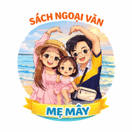

  

  <h1>Mẹ Mây — Sách ngoại văn cho bé</h1>
  
<em>Mỗi cuốn sách, một lần khám phá mới.</em>

  

    <a href="https://memaybooks.com"><strong>Website</strong></a> ·
    <a href="https://www.facebook.com/sachngoaivanmemay/"><strong>Facebook</strong></a> ·
    <a href="https://www.threads.com/@sachngoaivanmemay"><strong>Threads</strong></a> ·
    <a href="https://www.tiktok.com/@andamdaily"><strong>TikTok</strong></a> ·
    <a href="mailto:support@memaybooks.com"><strong>support@memaybooks.com</strong></a>
  

  

    
    
    
    
  

---

### Về Mẹ Mây

**Mẹ Mây** là tiệm sách ngoại văn đã qua sử dụng dành cho trẻ em, tuyển chọn các dòng board book, picture book, sách lật mở, tương tác, khoa học và truyện đọc theo từng lứa tuổi. Mỗi cuốn sách đều được chụp ảnh thật để phụ huynh dễ dàng chọn lựa cho bé.

> *Curated pre-loved English children's books — real photos for every copy, thoughtfully categorized by age group, format, and reading level.*

---

  © Mẹ Mây Books · All rights reserved.

