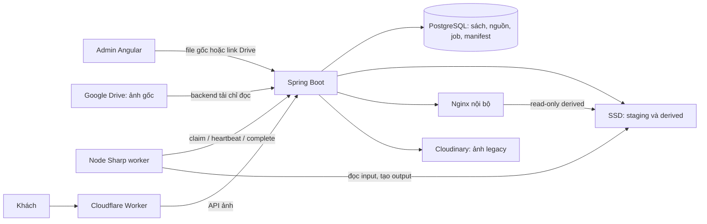
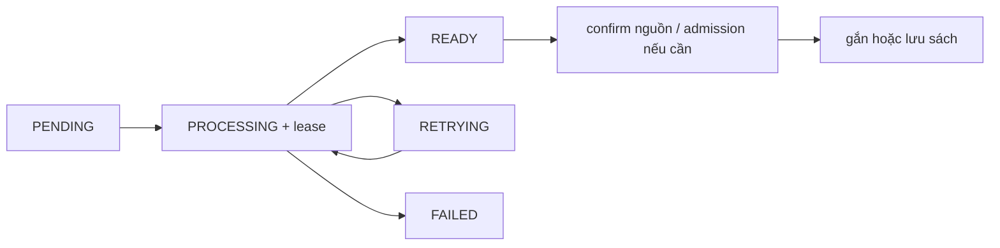

# Hệ thống ảnh Mẹ Mây — self-host và Cloudinary

Cập nhật 12/11/2026. Đây là tài liệu tổng quan và contract hiện hành của
feature ảnh, hợp nhất các quyết định được duyệt 08–11/11. Đối chiếu với code
trong repo; thông số triển khai thật phải kiểm trên môi trường vận hành.
Owner đã xác nhận luồng upload chạy mượt ngày 12/11. Điều đó không thay
bằng chứng benchmark, rollback hay chính sách backup còn thiếu.

## 1. Bản chất của thay đổi

Trước đây Cloudinary nhận, xử lý và giữ ảnh. Nay Mẹ Mây tự làm các việc đó
bằng Spring Boot, PostgreSQL, worker Node/Sharp, SSD và Nginx nội bộ.
Google Drive giữ bản gốc để khôi phục; Drive không phải CDN phục vụ khách.
Cloudflare vẫn phục vụ frontend/proxy/cache, không thay thế ổ lưu trữ ảnh.

Ảnh cũ tiếp tục có thể nằm ở Cloudinary. Đổi nơi nhận upload không tự chuyển
tất cả ảnh cũ sang LOCAL và không tự xóa Cloudinary. Từng ảnh có provider
riêng; cùng một sách có thể đọc ảnh từ cả hai provider.

| Nội dung | Cloudinary trước đây | Self-host `LOCAL` hiện tại |
|---|---|---|
| Xử lý | Backend gọi Cloudinary, yêu cầu eager variants | Worker Sharp/libvips tạo file trên SSD |
| Gửi từ máy | Browser chuẩn hóa JPEG trước gửi | Gửi nguyên bytes file gốc |
| Ảnh nguồn | Asset authenticated của Cloudinary | Drive File ID + hash đã xác minh |
| Bản phục vụ | Cloudinary giữ original/derived | `derived/` trên persistent SSD |
| Metadata | DB giữ asset/public ID và thông tin ảnh | DB giữ media, generation, manifest, nguồn, job |
| Thêm vào sách đã lưu | Upload thành công trả sách đã cập nhật | Encode READY rồi gắn vào sách |
| Ghép nguồn | Không so hash bản cloud đã nén với ảnh gốc | So SHA-256 bytes gốc, không dựa tên/thứ tự |
| Thu nhỏ | Eager JPEG1280; JPEG/WebP320/640 | Recipe v1: 9 output tạo trước, xem §7 |
| Delivery | Backend đọc ảnh authenticated qua adapter | Backend kiểm quyền rồi đọc Nginx nội bộ |
| Phục hồi | Giữ ref cloud và phương án ảnh gốc | DB backup + Drive + đúng recipe/worker |
| Chi phí/trách nhiệm | Quota và dịch vụ Cloudinary | Tự quản SSD, CPU/RAM, queue, backup, giám sát |

Không có số đo trong repo chứng minh LOCAL rẻ hơn hoặc nhanh hơn trên mọi
tải. Thiết kế nhắm tới 3.000 sách/24.000 ảnh; đây chưa là benchmark đạt tải đó.

## 2. Các thành phần và ranh giới



- Spring sở hữu quyền truy cập, DB, audit, nguồn Drive, queue và publication.
- Worker không có credential DB hoặc Drive; không được sửa sách trực tiếp.
- Nginx đọc file đã tạo; không decode hoặc resize theo từng request.
- Worker gọi management API có bearer token riêng, không dùng cookie OWNER.
  Endpoint `POST /actuator/imagejobs` ở cổng management8081 cho claim,
  heartbeat, complete và fail; không expose qua HTTP app/public ingress.
- Gateway public/admin chọn provider theo ảnh, không theo một cờ global.
- Không thêm MinIO, Redis, Google Picker, AI hoặc tự đồng bộ thư mục Drive.

## 3. Một ảnh gồm những gì?

| Khái niệm | Ý nghĩa |
|---|---|
| `mediaId` | UUID nhận diện ảnh; không lấy tên file hoặc mã sách làm key |
| Role | `FRONT`, `BACK`, `SPINE`, `INSIDE_1`…`INSIDE_5` |
| Generation | Một bộ output của media theo recipe; có serving pointer |
| Recipe | Công thức xử lý bất biến, kèm digest cấu hình/worker |
| Variant | File output: key, MIME, kích thước, bytes, SHA-256 |
| Manifest | Danh sách output của generation, dùng để kiểm trước công bố |
| Source binding | File ID Drive, hash/version/bytes/MIME, trạng thái xác minh |
| Job / lease | Công việc bền trong DB và quyền xử lý có thời hạn |
| Upload session | Phiên ảnh tạm thuộc owner, thời hạn 24 giờ |
| Receipt | Biên nhận để request lặp trả kết quả cũ, tránh nhân đôi |

Tách ba loại trạng thái: xử lý ảnh (`PENDING`…`READY`), vòng đời media
(`UPLOADING`, `ACTIVE`, `DELETE_PENDING`) và xuất bản sách. READY chỉ nói
ảnh đã xử lý xong, không tự có nghĩa đã gắn vào sách hoặc được public.

Tối đa 8 ảnh, mỗi role một ảnh ACTIVE. Xuất bản cần bìa và lưng; lưu Ẩn
có thể thiếu ảnh. Không còn nhóm ảnh nội bộ hay cờ ẩn/hiện riêng từng ảnh:
tất cả ảnh ACTIVE đi cùng trạng thái xuất bản của sách.
Alias `INTERNAL_1/2` chỉ giữ ở boundary URL/request cũ, tương ứng INSIDE_4/5.
Không sửa receipt/fingerprint/audit cũ chỉ vì đổi tên role.

## 4. Luồng A — upload ảnh từ máy

1. Angular hỏi `/api/v1/admin/media-capabilities` để biết provider/revision.
2. Với LOCAL, gửi đúng File gốc bằng multipart qua backend; không nén JPEG
   hoặc đổi kích thước trước khi gửi. Preview trên máy không đổi bytes nguồn.
3. Backend kiểm OWNER, CSRF, session, revision, capacity và request key;
   ghi input vào staging, tính SHA-256, tạo media/generation/job PROCESS.
4. Trả HTTP 202 với media ID, job ID và đường dẫn trạng thái. Worker xử lý
   phía sau; UI theo dõi và có thể phục hồi phiên sau reload.
5. Worker hoàn tất, backend kiểm file/manifest/lease rồi đưa ảnh về READY.
6. Có thể lưu sách Ẩn khi chưa có nguồn Drive. File từ máy **không tự được
   upload lên Drive**; owner phải giữ đúng bản gốc ở Drive để xác minh sau.
7. Xác minh từng ảnh bằng link/File ID hoặc dùng Tự ghép nguồn cho cả lô.
8. Sách mới: lần lưu sách consume phiên ảnh. Sách đã lưu: dùng Gắn tất cả
   ảnh vào sách cho các ảnh READY còn chờ gắn.

UploadLimiter giới hạn 300 lần/10phút/admin và 8 lượt đang xử lý trong
một backend instance; vượt trả429. Đây là limiter in-memory, không phải
quota phân tán hoặc rate limit đăng nhập. Worker encode vẫn concurrency1.

Cloudinary legacy vẫn dùng nhánh browser kiểm JPEG/PNG, auto-orient, flatten
nền trắng, giữ tỷ lệ trong cạnh dài 2560, JPEG quality 0,85 rồi gửi backend.
Hash file JPEG đã chuẩn hóa có thể khác file gốc; không dùng nó để giả định
nguồn Drive đã được xác minh cho ảnh Cloudinary.

## 5. Luồng B — nhập trực tiếp từ link Drive (`IMPORT`)

1. Dán 1–8 link **file ảnh** hoặc File ID, ngăn bằng dòng, khoảng trắng hoặc
   dấu phẩy. Không nhận link folder; từ chối File ID lặp.
2. Bấm Tải ảnh từ Drive. Backend tạo operation, khóa session và giữ slot ảnh
   tạm, tính cả ảnh đang upload để không vượt giới hạn phiên.
3. Backend tải từng file qua Drive API chỉ đọc, kiểm metadata trước/sau tải,
   hash bytes và chuyển chính input staging đó cho PROCESS. Không tải/nén
   lại ảnh chỉ để bàn giao cho worker.
4. Khi encode READY, xem thumbnail LOCAL và chọn vai trò. Thứ tự link chỉ
   là thứ tự trình bày; không suy bìa/lưng theo filename.
5. Bấm Xác nhận các ảnh đã chọn. Backend kiểm metadata nguồn chưa đổi và
   generation/hash/recipe; ghi binding VERIFIED, cấp admission cho tập chọn.
6. Trước confirm, ảnh không được đưa qua session/finalize/commit dù biết ID.
   Có thể bỏ dòng lỗi và confirm phần thành công; phần chưa chọn bị giải phóng.
7. Sau confirm, khối Drive chỉ hiện tổng kết `n/tổng`; ảnh xuất hiện một lần
   trong bộ ảnh sách. Sách mới lưu bình thường; sách cũ dùng Gắn tất cả.

Một lượt thành công tải bytes mỗi nguồn một lần; confirm kiểm metadata,
không download lại để VERIFY. Retry mạng có thể cần tải lại.
IMPORT tạo ảnh mới; không phải cách chỉ bổ sung nguồn cho ảnh đã gắn sẵn.

## 6. Luồng C — ghép nguồn cho ảnh đã tải (`MATCH`)

1. Giữ các ảnh LOCAL READY đang có, dán link gốc rồi bấm Tự ghép nguồn.
2. Backend chụp snapshot generation/hash/binding version và book version.
3. Tải nguồn Drive, tính SHA-256 và tìm candidate có cùng hash trong tập
   target của **cùng sách hoặc session**, không dò toàn kho.
4. Hash khác nhau: tự ghép đúng dù link đảo thứ tự. Nhiều ảnh cùng hash:
   owner chọn cặp một-một; không tự quyết định ảnh nào khi mơ hồ.
5. UI dùng ảnh ở bộ ảnh sẵn có; kết quả nguồn đánh số `1/5`… và lựa chọn
   role/candidate, không nhân đôi thumbnail. Lý do khóa confirm được hiện rõ.
6. Confirm kiểm lại source metadata/snapshot/version, ghi VERIFIED và audit;
   với sách đã lưu, tăng version một lần cho tập xác nhận.

MATCH không upload lại ảnh, không encode lại, không đổi role hoặc tạo thêm
media. Nếu ảnh đã gắn vào sách, không cần bấm Gắn tất cả sau khi MATCH.
Ảnh còn ở phiên tạm vẫn cần bước lưu/gắn như trước.
Không trộn target đã gắn và target pending replacement trong cùng một lô.

## 7. Ảnh được xử lý thế nào?

LOCAL nhận JPEG/PNG/WebP tĩnh, tối đa **10 MiB/file, 25.000.000 pixel**.
Kiểm signature/magic, MIME, decode, width/height và một frame. Đuôi file
không đủ chứng minh ảnh hợp lệ; không nhận HEIC, SVG, PDF hoặc ảnh động.
Backend giới hạn bytes; Sharp kiểm decode/pixel/frame trước xuất ảnh.

Code nguồn: [recipes.mjs](../code/image-worker/src/recipes.mjs),
[processor.mjs](../code/image-worker/src/processor.mjs).
Recipe `v1`, Sharp `0.35.5`, Node tối thiểu 22:

| Output | Format | Quality | Vai trò |
|---|---|---:|---|
| 320, 480, 640, 1400 | JPEG + WebP ở mỗi size | JPEG 85 / WebP 82 | 8 file cho thumbnail/detail và tương thích |
| 1280 | JPEG | 85 | 1 file tương thích preview/admin |

Tổng cộng **9 output/generation** ở lượt encode đầy đủ. PREVIEW migration
chỉ tạo JPEG480 để đối chiếu, không phải generation đã hoàn tất để phục vụ.
Size là bounding box: `fit: inside`, giữ tỷ lệ và **không upscale**.
Ví dụ 1200×1800 ở size480 thành 320×480; ảnh nhỏ hơn480 không bị kéo lớn.

Pipeline: decode → tự xoay EXIF → resize → alpha nền trắng → sRGB → encode.
Output không giữ EXIF/GPS; không crop, sửa nội dung, retouch che lỗi sách
hoặc thêm watermark. Watermark mới phải có recipe version mới nếu được duyệt.
Resize đã làm trước, không gọi Sharp lúc khách mở ảnh.

Recipe/version/config/worker image phải ghim để rebuild. Không sửa recipe v1
đã dùng rồi coi đó là cùng công thức; không chỉ lưu size/quality là đủ.
Worker xử lý một file có giới hạn bytes, tạo variant tuần tự; không nạp cả
kho ảnh vào RAM. Giới hạn 25MP vẫn cần đo peak RSS trên server thật.

## 8. File gốc, file tạm và dữ liệu bền

```text
/srv/memay/images/
  staging/<operation-or-lease-uuid>/input
  staging/<lease-uuid>/output/...
  derived/<media-uuid>/<generation-uuid>/<size>.jpg|webp
```

Staging và derived cùng persistent filesystem để công bố bằng atomic rename.
Backend/worker ghi root; Nginx mount derived read-only. Cấm traversal/symlink,
key do server tạo; filename gốc và book code không là đường dẫn tin cậy.

**Staging không phải kho backup ảnh gốc.** Input/attempt không còn tham chiếu
hợp lệ có thể bị sweeper dọn sau grace. Bản gốc dài hạn nằm ở Drive; SSD giữ
derived. PostgreSQL giữ metadata, không chứa toàn bộ bytes ảnh.
Filesystem và transaction DB không là một transaction phân tán: kiểm lại
pointer, dọn staging orphan có grace, giữ ảnh cũ nếu công bố/ghi DB thất bại.
Không ghi đè immutable key của generation đã công bố.

## 9. Queue, retry và gắn ảnh



- Queue bền trong PostgreSQL; claim atomic, lease 5 phút, heartbeat 30 giây.
- Worker concurrency 1; cấu hình mẫu 1 CPU/768 MiB là điểm xuất phát thử nghiệm.
- Encode chạy subprocess timeout 180 giây. Tối đa 3 attempts tự động,
  backoff 10/60 giây; token hết hạn không được công bố kết quả.
- PROCESS, MIGRATE, REBUILD và PREVIEW dùng cùng processor; VERIFY và tải
  Drive do backend xử lý. Worker không nhận arbitrary URL/path/recipe.
- Backend kiểm đủ manifest, MIME, dimensions, byte count và hash trước
  chuyển serving pointer. Worker xong không tự xuất bản hoặc thay ảnh sách.
- Lỗi giữ ảnh cũ; pending/FAILED không được giả READY. Retry thủ công PROCESS
  chỉ khi session/media còn hợp lệ và có audit.

Gắn tất cả gọi API commit từng ảnh **tuần tự**, dùng version vừa nhận cho
ảnh sau. Đây là một thao tác UI, không phải transaction atomic cho toàn lô.
Tiến độ `0/5`…`5/5`; lỗi dừng, giữ phần thành công, thử lại phần còn pending.
Khóa sửa ảnh trong lúc chạy; double click không tạo lượt thứ hai.

Nút gắn riêng xuất hiện ngày 09/11/2026, commit `dceef69`, khi tích hợp LOCAL.
Cloudinary upload trên sách đã lưu trả BookDetail đã gắn ngay; LOCAL tách
prepare/commit để ảnh mới chưa READY không thay ảnh cũ. Hai giai đoạn kỹ thuật
không bắt buộc owner bấm từng ảnh; UI được gộp thành một nút ngày11/11 (`f868c85`).
Sách mới vẫn gắn ảnh qua lần lưu sách, không cần nút commit riêng.

## 10. Xác minh nguồn và chống ghi đè

Nguồn có trạng thái UNVERIFIED, VERIFIED, SOURCE_MISSING, SOURCE_CHANGED hoặc
ACCESS_ERROR. File ID tồn tại không đủ; SHA-256 phải khớp bytes gốc của
generation. `sourceRef` chỉ là ghi chú, không phải binding đã xác minh.
Đổi nội dung nguồn cần replacement/generation mới, không sửa hash để lách gate.
Đang kiểm một candidate mới không được phá binding VERIFIED đang dùng.

Hotfix được owner duyệt12/11: thiếu nguồn LOCAL không chặn create+publish,
update+publish, publish riêng, gắn/thay ảnh hoặc sửa sách đang công khai.
Vẫn kiểm READY/admission, đủ bìa/lưng, dữ liệu bắt buộc, OWNER và version.
Danh sách admin trả `unverifiedSourceRoles` cho ảnh LOCAL ACTIVE chưa VERIFIED
đúng input hash/generation; cả dòng nền đỏ nhạt và nêu vai trò chưa xác minh.
Nguồn mất/đổi/lỗi quyền hoặc hash lệch cũng tiếp tục cảnh báo; khi nguồn hợp
lệ hoặc ảnh không còn ACTIVE thì cảnh báo tương ứng tự hết ở lần tải danh sách.
Cloudinary legacy không bị gắn cảnh báo thiếu nguồn LOCAL. Không đổi trạng thái
nguồn thành VERIFIED để cho xuất bản; migration/rebuild giữ kiểm nguồn riêng.

Mutation kiểm OWNER, CSRF, expected version, owner/session/namespace và audit.
Request key/payload lặp trả receipt cũ; khác payload trả conflict. Confirm lô
atomic trên tập chọn, kiểm digest và source snapshot. Refresh snapshot đổi
thì lần confirm tiếp dùng digest mới; response mạng mất không tự tạo bản sao.
Consume session hủy phần lô còn lại; callback cũ không phục sinh media đã gỡ.
TTL lô tối đa 24 giờ, không vượt session. Reservation lỗi terminal/cancel/expire
được trả lại; IMPORT chưa confirm không thể vượt admission bằng media ID.

## 11. Google Drive và giảm request

Backend dùng service account chỉ đọc, credential từ secret mount. Folder gốc
chia sẻ Viewer có thể chứa folder con theo sách; kiểm quyền tải/kế thừa và
limited access. Không cần public folder, không quét cả Drive, không nhận URL
tải tùy ý. Nếu policy không cho service account, cần quyết định tích hợp khác.
API host cố định, timeout/bytes bị chặn, metadata version/size kiểm trước/sau.
403 là lỗi quyền/config/quota; 404 không chứng minh chắc chắn file bị xóa.
Nguồn VERIFIED chỉ đúng tại lúc kiểm, không hứa file vẫn còn nguyên về sau.

UI một poller cho lô: 1 → 2 → 5 giây, dừng khi terminal/rời form; tab ẩn dừng,
hiện lại lấy trạng thái. Reload khôi phục operation và ảnh tạm hợp lệ; receipt
lịch sử không được làm sống lại ảnh đã gỡ. Logout/auth epoch đổi hủy context cũ.
CSRF cache/in-flight chia sẻ trong bộ nhớ theo auth epoch; chỉ refresh/retry
một lần với `403 csrf_invalid`, không replay mọi lỗi mạng hoặc lỗi phân quyền.
Mô hình MATCH: create + P lần GET + confirm, cộng CSRF/session/preview/retry
nếu có. Đây là mô hình request, chưa phải benchmark latency hoặc quota Drive.

## 12. Delivery, public và ZIP

Khách gọi cùng-origin `/api` qua Worker/Tunnel; Spring kiểm sách PUBLISHED,
media ACTIVE, generation/version rồi Nginx đọc SSD nội bộ. Sách Ẩn/Thùng rác,
token version sai/cũ trả404 tại backend; public DTO không lộ key/File ID/secret.
Admin/preview kiểm session/quyền và `no-store`; không trả signed provider URL.
LOCAL trả danh sách variant thực sự có; UI không áp size1400 lên ảnh cloud
chỉ có320/640. ZIP OWNER stream JPEG qua gateway đúng provider, không lộ nguồn.

Cache browser revalidate, edge tối đa30giây/purge sau commit theo ARCHITECTURE.
Không cache lỗi/admin/token; tắt edge cache nếu chưa đủ policy/purge. Generation
key bất biến không có nghĩa browser được giữ vĩnh viễn sau khi sách chuyển Ẩn.
Không hứa thu hồi bytes người dùng đã tải. Nginx/SSD và management8081 không
được expose trực tiếp ra Internet; hostname ảnh tùy chọn vẫn phải qua gate này.

## 13. Cleanup và khôi phục

Cleanup LOCAL có grace1giờ, mỗi lượt có giới hạn; không xóa media ACTIVE hoặc
file của lease/session/job còn hợp lệ. Ảnh gỡ/chờ xóa đi qua DELETE_PENDING,
hủy job và kiểm pointer trước dọn generation/staging/metadata. Migration giữ
cloud ref phục vụ rollback; không tự xóa cloud chỉ vì đã chuyển LOCAL.

Khôi phục cần **DB backup + đúng nguồn Drive + đúng recipe/config/worker**.
Chỉ giữ link hoặc key service account không đủ biết sách/role/generation nào.
R2 là nơi backup DB theo vận hành owner, không là nơi chứa ảnh phục vụ web.
Không cần full derived backup hằng ngày sau khi quy trình recovery đã được
kiểm chứng; vẫn phải giữ và kiểm chính sách backup metadata/secret/recipe.

Inventory so file thật với manifest. Rebuild tải nguồn đúng hash, encode bằng
recipe đã ghim, kiểm output hash/key rồi công bố. Hash khác báo RECIPE_MISMATCH,
không overwrite key cũ; nguồn đổi/mất/quyền lỗi báo riêng, giữ derived còn tốt.
Không chạy rebuild inline khi khách GET. FRONT published được ưu tiên, sau
đó ảnh public khác, sách Ẩn và Thùng rác còn hạn; việc tương tác ưu tiên hơn.
Gallery thiếu ảnh dùng fallback/placeholder cố định, không lấy ảnh sách khác;
recovery không tự publish sách hoặc phục sinh media đã dọn vĩnh viễn.

Restore DB vào instance/mount riêng với profile `restore`, mặc định isolated:
khóa outbound/claim/cleanup. Kiểm namespace, metadata, recipe, lease rồi mới
bật active. File ngoài DB restore được report/quarantine, không tự gắn/xóa.
RPO phụ thuộc độ mới backup DB và coverage nguồn; RTO phải đo, không cam kết trước.
Drive bị xóa do owner xử lý thủ công; không có đồng bộ/giám sát Drive liên tục.

## 14. Chuyển ảnh Cloudinary cũ và rollback

Quyết định hiện hành: giữ ảnh Cloudinary cũ; migration đợt cũ được hoãn.
Tool đã có: xuất manifest CSV, dry-run/preview, apply và rollback theo scope.
Header: `media_id,book_code,role,drive_file_id,expected_book_version`.
Giới hạn100ảnh/lô, receipt24giờ; OWNER đối chiếu preview ảnh cũ/nguồn và chọn
explicit media IDs. Không dùng hash ảnh cloud đã nén để đoán bản gốc.
Apply tải lại/kiểm version/hash, tạo LOCAL generation; chỉ swap khi đủ ảnh
của sách READY, tăng book version một lần, giữ source/ref cloud và audit.
Sách khác thành công được giữ; dòng/sách lỗi cần xử lý riêng/dry-run lại.

Rollback chỉ đổi pointer còn đúng generation/version receipt, không đè ảnh
mới thay sau đó. LOCAL mới không có cloud fallback: rollback code phải dùng
binary vẫn đọc LOCAL; dừng thao tác nhập mới khi xử lý, không về binary cloud-only.
`MEMAY_IMAGE_LOCAL_ENABLED=false` còn tắt LocalMediaGateway, không chỉ upload;
không dùng nó như công tắc tắt ghi nhưng vẫn đọc LOCAL. Hiện chưa có cờ tách
riêng hai chức năng đó; operator phải giữ đường đọc cho media đã có.
Không drop schema hay xóa Cloudinary để thử chứng minh rollback/rebuild.

## 15. Khi gặp lỗi

| Lỗi/tình huống | Ý nghĩa và bước xử lý |
|---|---|
| Nền đỏ nhạt ở dòng admin | Nguồn LOCAL chưa xác minh; vẫn xuất bản được, bổ sung nguồn đúng để khôi phục |
| `source_hash_mismatch` | Bytes không giống file đã upload; dùng đúng bản gốc, không sửa hash để vượt kiểm |
| `SOURCE_CHANGED` | Nguồn đổi sau snapshot; xử lý nguồn rồi tạo lượt xác minh mới |
| `ACCESS_ERROR` / `SOURCE_MISSING` | Kiểm credential/quyền tải/file; không mặc định xóa ảnh đang có |
| Version/digest conflict409 | Giữ nội dung đang sửa; đọc bản hiện hành, refresh hoặc tạo lô mới theo lỗi |
| `image_capability_changed` | Tab giữ provider/revision cũ; nạp capability mới trước gửi lại file gốc |
| `image_recipe_unavailable` | Operator kiểm recipe đã đăng ký và worker/config digest |
| Session/lô410 | Đã hết hạn; tạo phiên/lô mới, không tiếp tục ghi bằng receipt hết hạn |
| Upload429 hoặc worker/disk lỗi | Chờ quota/khôi phục tài nguyên, kiểm job và retry có kiểm soát |

## 16. Bản đồ code, API và tài liệu

| Trách nhiệm | Nguồn trong repo |
|---|---|
| Upload/lifecycle | [backend media](../code/backend/src/main/java/vn/memay/media/): LocalUploadService, UploadSessionTransactions, MediaTransactions |
| Queue/manifest/store | `ImageJobService.java`, `ImageJobRepository.java`, `LocalImageStore.java` trong cùng package |
| Drive/batch | [source](../code/backend/src/main/java/vn/memay/media/source/): DriveBatchService, GoogleDriveSourceClient |
| Đọc/migrate/recover | `MediaReadService.java`, `ImageMigration*`, `ImageRecovery*`, `ImageInventoryService.java` |
| Worker | [code/image-worker](../code/image-worker/) |
| UI | [books](../code/frontend/src/app/features/admin/books/): queue, drive-batch, media panel |
| Cấu hình mẫu | [ops/images](../ops/images/) |

Các tên class khác trong bảng cùng thuộc package backend media.
API admin dưới `/api/v1/admin`: `media-capabilities`, `upload-sessions`,
`image-operations/{jobId}` (+ retry), `media/{mediaId}/source`,
`drive-image-batches` (+ GET/confirm/DELETE),
`books/{id}/media/replacements/{mediaId}/commit`, `image-migrations`, `image-recovery`.
HTTP bookId trong batch là chuỗi decimal64-bit; snapshot target có thể chỉ mediaId.
Nếu gửi generationId tường minh phải kèm bindingVersion hợp lệ. Backend không
tắt strict JSON coercion toàn cục để nhận request sai kiểu.

Migration V24–V31, giữ nguyên các migration đã chạy và V21–V23 chấm công.
V24 đổi role/visibility, V25 generation/job, V26 nguồn, V27 upload LOCAL,
V28 receipt, V29 migration apply, V30 recovery, V31 Drive batches.
Quy trình ban đầu cần backup/counts/checksum, dừng ghi/reload admin khi đổi
schema không tương thích; không rolling hai payload/schema trái nhau.

Đọc [runbook](IMAGE_OPERATIONS.md) để thao tác; [kiểm chứng](IMAGE_VERIFICATION.md)
để biết đã đạt gì và tiêu chí nào cần bằng chứng. [PROGRESS](PROGRESS.md) là
snapshot/gate duy nhất; DEV_LOG giữ lịch sử, không suy log cũ là trạng thái live.
