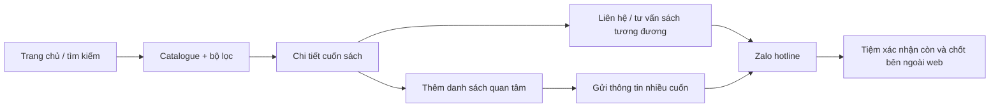
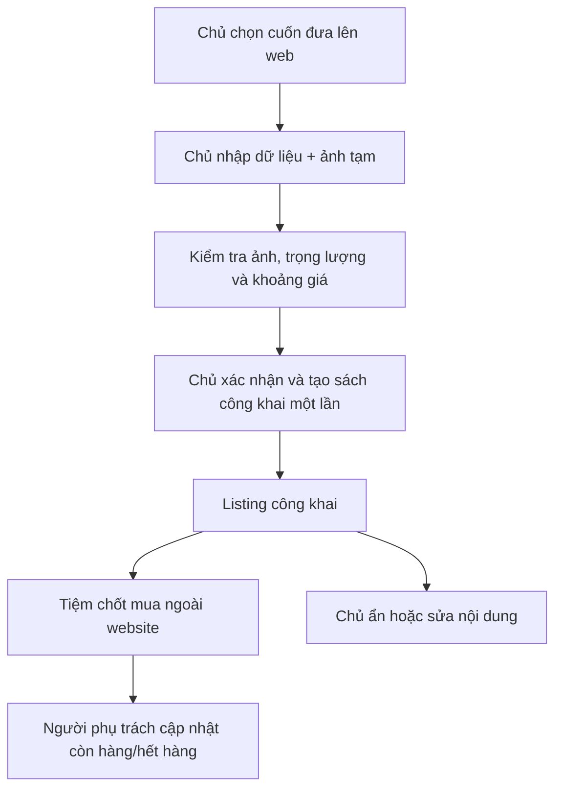
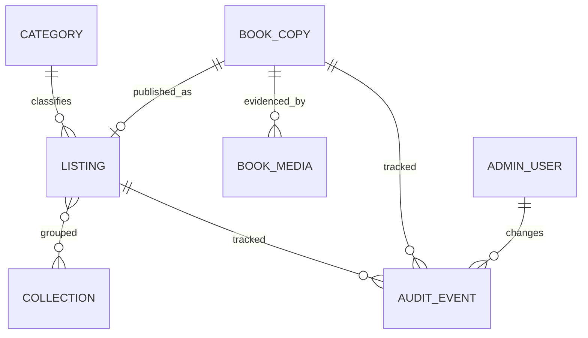
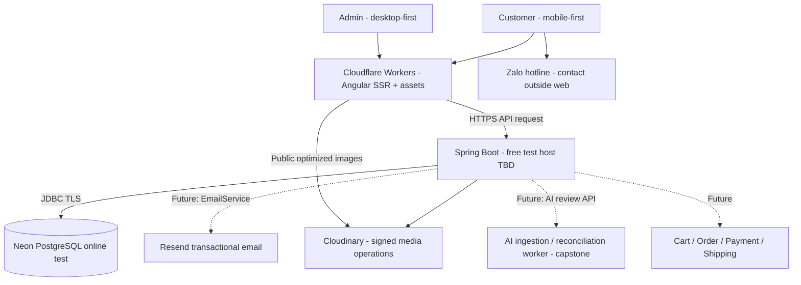

# MASTER PLAN — WEBSITE MẸ MÂY

**Bản hiện hành | Cập nhật 28/10/2026 | User publish21/21; M5 còn originfix, case biên và recovery/performance**

> **Mục tiêu:** Làm một website sách có trải nghiệm tìm và xem sản phẩm tương tự các website bán sách phổ biến (tham khảo [NXB Kim Đồng](https://nxbkimdong.com.vn/)), nhưng xử lý đúng bản chất sách cũ Mẹ Mây. MVP chỉ là **catalogue + danh sách quan tâm + liên hệ hỏi mua** và **quản trị sản phẩm**. Không tạo đơn, giữ hàng tự động, thanh toán hoặc thay thế vận hành Excel/Facebook/Zalo. Thiết kế có đường mở rộng lên e-commerce và capstone AI, nhưng **không xây sẵn những module chưa sử dụng**.

> **Cập nhật theo yêu cầu ngày 21/10/2026:** Giữ Angular trên Cloudflare. Backend và PostgreSQL tự quản trên VPS/Dokploy. Các proposal và phiên bản cũ đã được gộp/xóa; lịch sử xem trong Git.

> **Điều chỉnh M1 đã được duyệt ngày 22/10/2026:** triển khai nền tảng local, dùng PostgreSQL container hiện có. Docker hóa ứng dụng, CI/CD và deploy Cloudflare/VPS chuyển sang giai đoạn sau. Chi tiết thực thi và trạng thái nằm ở [báo cáo kiểm tra M1](VERIFICATION.md) và [PROGRESS](PROGRESS.md).

> **Điều chỉnh trước M5 ngày25/10/2026:** M3/M4 đã được user test và publish GitHub; chỉnh sửa còn lại để sau MVP. User **chốt Cloudflare Workers cho frontend để giữ SSR**, thay lựa chọn Pages trước đó, và cung cấp Neon qua .env. Ngày26/10 user chọn Render me-may-api; Docker/Workers config đã chuẩn bị, Neon V1–V5 migrate/validate đạt. Ngày27/10 user đã deploy; kiểm chứng health/SSR/privacy/auth online đạt. Ngày28/10 user xác nhận publish20desktop+1mobile thành công21/21, copy/mởZalo/ẩn/FlashSale ổn; agent kiểm online detail3ảnh/OG đạt. Originfix enquiry/canonical đang bàn giao dev; checklistcasebiên ở VERIFICATION. M5 chưa đóng; chưa thuê VPS. Production VPS/Dokploy và gate SEO/security/backup/restore giữ riêng, không coi test miễn phí là production.

> **Baseline trước M2 được duyệt ngày 22/10/2026:** MVP nhập thủ công, lọc tuổi/thể loại, mỗi cuốn một thể loại, Picture book bắt buộc Paperback hoặc Hardcover, ba ảnh thật, giá và mức đọc tham khảo, liên hệ Zalo theo khả dụng. Import CSV/Excel là bước ngay sau MVP, không phải điều kiện ra mắt. Quyết định này thay thế các mặc định M0 tương ứng; chưa triển khai code M2.

> **Điều chỉnh nhập sách duyệt30/10/2026:** ngôn ngữ mới mặc định “Tiếng Anh” sửa được,
> hai ô giá có dấu phân nhóm nghìn, ảnh đổi vai trò chỉ qua dropdown. Tình trạng mới
> “Độ mới cao”/“Có lỗi nhẹ”; thêm biến thể có tồn riêng, tổng tự cộng, giá khoảng chung.
> Quyết định này thay baseline mã theo từng bản vật lý/ảnh riêng từng cuốn; chi tiết ở DATA/DESIGN.

> **Import duyệt31/10/2026:** [BOOK_IMPORT](BOOK_IMPORT.md) thay các nhắc
> “import tạo nháp” bên dưới bằng tạo nguyên lô sách mới ARCHIVED sau kiểm cả file;
> thêm ảnh rồi OWNER tự publish, không thêm DRAFT. Đã triển khai local; không là gate MVP.

### Phạm vi M1 local đã thực hiện

Angular 21.2 standalone/SSR-ready; Java 21/Spring Boot 4.1.1; PostgreSQL 18.4 container có sẵn với database dev/test riêng. Đã có Flyway, session OWNER/STAFF, CSRF, owner cố định được cấp bằng one-shot command, không startup bootstrap, shell public/admin và đăng nhập. Contract API và cách chạy ở [README](../README.md); bằng chứng/giới hạn ở [VERIFICATION](VERIFICATION.md). Chưa có CRUD sách, Cloudinary upload, Home đầy đủ hoặc wishlist. Docker hóa ứng dụng, CI/CD và deploy được hoãn; bảng M1 bên dưới mô tả đích foundation đầy đủ, không có nghĩa staging đã nghiệm thu.

## 0. Chốt quyết định và giới hạn

| Vấn đề | Quyết định hiện tại | Ghi chú triển khai |
|---|---|---|
| Nguồn tham khảo | Website NXB Kim Đồng | Tham khảo IA/luồng UX, **không sao chép** thương hiệu, hình ảnh, UI một-một hoặc nội dung |
| Customer | **Mobile-first** | Responsive từ 360–390 px; cần thử cả Facebook/Zalo in-app browser |
| Admin/merchant | **Desktop-first** | Tối ưu bảng, form nhiều trường, quản lý ảnh và tìm kiếm; tablet dùng được, mobile admin không phải ưu tiên |
| Tính năng khách ở MVP | **A + B**: duyệt catalogue, tìm/lọc/sắp xếp, chi tiết cuốn sách, hỏi mua một cuốn, danh sách quan tâm nhiều cuốn | Danh sách quan tâm **không phải giỏ hàng**, không tạo đơn, không tự giữ sách |
| Người chọn sách trên web | **Chủ tiệm** | Nhân viên có thể hỗ trợ nhập liệu; phân quyền xuất bản theo thiết kế bên dưới |
| Chốt mua | **Zalo hotline cá nhân có zBusiness**, ngoài website | Detail dùng Zalo; Facebook vẫn có thể là link thông tin cửa hàng. Không tự gửi tin |
| Kho & đơn livestream | **Giữ luồng hiện tại** | Không ép livestream → website, không tự đồng bộ Excel/Zalo |
| Sách cũ | **Một mục sách = mã MM, các biến thể có tồn riêng** | User duyệt30/10: dùng chung thông tin/ảnh/khoảng giá; tổng tồn tự cộng, không theo dõi từng bản vật lý |
| Tech stack | Angular + Spring Boot + **PostgreSQL** + Cloudinary | Local giữ Docker; test online dùng Neon đã cung cấp; chỉ Spring truy cập JDBC |
| Hosting frontend | **Cloudflare Workers + Angular SSR**, user đã chốt | Cần spike runtime/SSR/SEO/OG thực tế; upload browser assets không tự có SSR |
| Hosting backend | Test: dịch vụ miễn phí do user chuẩn bị, ví dụ Render | Chưa thuê VPS/chốt provider; VPS + Dokploy là hướng production hoãn, không chặn test online |
| Email | **Resend (sau MVP)** | Dự trù cổng tích hợp, chưa làm gửi mail/notification tại MVP |
| Bước ngay sau MVP | **Import CSV/XLSX tạo sách mới Ẩn** | Contract31/10 ở BOOK_IMPORT/DATA; receipt retry, thêm ảnh rồi chủ publish |
| Mở rộng sau đó | Import cập nhật sách; giỏ hàng/đặt hàng → thanh toán/giao vận → AI số hóa/đối soát | Mỗi bước cần đặc tả riêng |

### 0.1. Quy tắc MVP hiện hành (M5 duyệt 29/10/2026)

1. **Giá tham khảo là khoảng từ–đến**, hai số nguyên VND 1..999999999999, từ ≤ đến; bằng nhau hiển thị một giá. Kèm ghi chú “Giá sẽ thay đổi dựa vào tình trạng sách cụ thể.” Không tự suy ra giá từ ảnh/Excel; giá chốt do tiệm xác nhận ngoài web.
2. **Chủ tiệm duyệt tập sách đăng bằng quyền xuất bản** (`OWNER`); nhân viên (`STAFF`) chỉ đọc quản trị; OWNER thực hiện mọi ghi. Không có tạo/lưu nháp. Trường hợp chủ trực tiếp đăng, không buộc đi qua bước duyệt thừa. Đây là lựa chọn kỹ thuật mặc định, không phải khẳng định tất cả công việc ở tiệm đều cần phê duyệt.
3. **Wishlist lưu trong trình duyệt** (localStorage) và không cần tài khoản; nó chỉ tồn tại trong cùng trình duyệt/thiết bị, có thể mất khi xóa dữ liệu hoặc dùng ẩn danh. Khi mở danh sách, đọc trạng thái mới nhất từ server; không tự động gửi dữ liệu cho tiệm.
4. **Liên hệ theo khả dụng:** còn hàng dùng “Liên hệ”; hết hàng dùng “Tư vấn sách tương đương”. Cùng mở Zalo hotline cá nhân có zBusiness; chuẩn bị mục đích hỏi, mã, tên, giá tham khảo và URL. Chỉ cam kết điền sẵn sau kiểm chứng; MVP chấp nhận sao chép → mở Zalo → khách dán/gửi, có copy thủ công nếu clipboard lỗi. Nút cộng đồng mở link nhóm Zalo riêng.
5. **Tình trạng khả dụng** tính từ tổng tồn biến thể: >0 là `AVAILABLE`, 0 là `SOLD`; chủ cập nhật tồn sau bán ngoài web. Không có Đang giữ; dữ liệu vẫn có thể trễ so với Page/livestream.
6. **Sách hết hàng** tiếp tục có trang chi tiết hiển thị “Hết hàng” để giữ link cũ, mặc định không ưu tiên trong danh sách. Chủ vẫn có thể ẩn riêng mục đăng.
7. **Tuổi/thể loại và mức đọc** do chủ chọn thủ công theo mục 3.1; độc lập với nhau. Không tự suy mức đọc từ tuổi/thể loại hoặc tự gán tuổi khi thiếu căn cứ. Mức đọc không bắt buộc để xuất bản.
8. **Nhập thủ công trong MVP**, 2–6 ảnh thật, bắt buộc bìa và lưng mới được xuất bản; tình trạng/lỗi vẫn mô tả bằng chữ. Import CSV/Excel triển khai ngay sau MVP.

Các quy tắc trên là baseline MVP đã duyệt; không suy thêm cam kết về chính sách giao hàng, hoàn trả hay thời hạn giữ sách. Nội dung chính sách chỉ công bố khi tiệm cung cấp nội dung hợp lệ.

## 1. Phân tích website tham khảo và mức độ học theo

### NXB Kim Đồng (quan sát nội dung trang công khai ngày 21/10/2026)

- Trang chủ tổ chức **danh mục theo độ tuổi, bộ sưu tập và nhóm sản phẩm**; có ô tìm kiếm lớn và thẻ sản phẩm.
- Trang bộ sưu tập có **lọc thể loại, nhà xuất bản, khoảng giá**, sắp xếp theo tên/giá/mới-cũ.
- Trang chi tiết có **mã sản phẩm, giá, tình trạng, ISBN, tác giả, khuôn khổ, số trang, định dạng, trọng lượng** khi được khai báo; trang Kim Đồng còn có thêm giỏ hàng/mua ngay.

**Giữ lại cho Mẹ Mây:** cấu trúc IA, danh mục/độ tuổi, card sách, tìm kiếm, sort/filter, trang chi tiết và metadata chia sẻ.
**Thay đổi cho Mẹ Mây:** ưu tiên bộ ảnh chung của **đúng sách**, xác nhận bản cụ thể khi khách hỏi, phần tình trạng/lỗi, loại sách Picture/Board/Chapter, bằng chứng trang ruột, mã cuốn duy nhất; thay nút giỏ/mua bằng hỏi mua/danh sách quan tâm.
**Không bê sang:** khuyến mãi giả định, kho theo số lượng của một SKU, combo tự động, đánh giá sao không có dữ liệu, checkout, tin tức phức tạp.

Nguồn tham khảo: [Trang chủ](https://nxbkimdong.com.vn/), [Ví dụ trang bộ sưu tập](https://nxbkimdong.com.vn/collections/em-biet-gi), [Ví dụ trang chi tiết](https://nxbkimdong.com.vn/products/lo-au-oi-tam-biet-tro-chuyen-ve-suc-khoe-tam-than-chung-roi-loan-lo-au).

## 2. Sitemap và UX cần thiết

Home lấy bố cục từ ảnh `docs/assets/nxbkimdong.com.vn.png` do người dùng cung cấp: nhiều hàng sách, banner ngang và footer, không chuyển sang landing kể chuyện ít sản phẩm. Thiết kế M0 đã được người dùng duyệt; xem [DESIGN](DESIGN.md). Visual chi tiết và dữ liệu pilot thật vẫn cần hoàn thiện.

| Khu vực | Route gợi ý | Nội dung MVP |
|---|---|---|
| Home | `/` | Header/search, menu danh mục, banner ngang lớn, các hàng sách/bộ sưu tập và banner xen kẽ theo ảnh tham khảo người dùng; xem DESIGN.md |
| Catalogue | `/sach` | Grid, search, filter, sort, pagination; URL giữ filter |
| Collection | `/bo-suu-tap/:slug` | Tập sách chủ/nhân viên biên tập |
| Detail | `/sach/:slug` | 2–6 ảnh thật, trọng lượng gram, tiêu đề ghép, giá tham khảo/mã/tình trạng, mô tả, mức đọc, link video đọc sách, trái tim và CTA Zalo |
| Wishlist | `/quan-tam` | Danh sách lưu trên thiết bị; xóa sách; refresh trạng thái; copy danh sách |
| About/How to buy | `/gioi-thieu`, `/cach-mua`, `/lien-he` | Nội dung và link thật do tiệm cung cấp |
| Admin | `/admin/...` | Login, dashboard thao tác, danh sách sản phẩm, editor, media, taxonomy |

**Customer mobile-first:** thanh tìm kiếm dễ thấy; thẻ sách có ảnh nổi bật + giá + tag tình trạng; lọc hiển thị qua bottom sheet; hình thực tế có thứ tự; nút hỏi mua/danh sách quan tâm ở vùng dễ bấm; không che ảnh sách bằng banner. Điều hướng qua lại giữ từ khóa và bộ lọc.

**Admin desktop-first:** thanh điều hướng trái, bảng rộng, tìm mã nhanh, bộ lọc trạng thái, edit trên trang rộng, ba vị trí ảnh có vai trò cố định, preview bản công khai; không yêu cầu dashboard phân tích doanh thu.

### 2.1. Luồng khách hàng



Quy tắc sản phẩm: thao tác thêm danh sách không gọi `POST /orders`, không đổi `availability`, không tạo `reservation` ở server, không yêu cầu số điện thoại/địa chỉ khách.

### 2.2. Luồng quản trị



Không nối trực tiếp livestream claim, cọc 100.000đ/đơn, quy định giữ tối đa 2 tuần, J&T, sổ đơn Excel hay nhóm Zalo vào các luồng công khai ở MVP. Những quy tắc đó vẫn tồn tại trong vận hành thật, nhưng không có nghĩa chúng tự động áp dụng cho khách đến từ web.

## 3. Đặc tả phạm vi MVP (đủ để mở ticket)

### P0 — bắt buộc

**Public catalogue**
- Hiển thị Home, catalogue, collection, detail và các trang thông tin cơ bản.
- Search theo tên/mã, case-insensitive; hỗ trợ tiếng Việt không dấu nếu có thể thực hiện bằng PostgreSQL unaccent hoặc giải pháp tương đương; chỉ công khai published listing.
- Filter public **chỉ độ tuổi và thể loại**, với kiểu bìa nằm trong Picture book; chi tiết ở mục 3.1. Giữ sort mới nhất, giá tham khảo tăng/giảm; không có lọc giá, chủ đề, khả dụng hoặc mức đọc trong MVP.
- Mã sách/slug ổn định; HTML ban đầu cho trang sách/danh sách có SEO title/description/canonical/OG image bằng giải pháp render được **kiểm chứng trên Cloudflare** (SSR hoặc SSG với cập nhật phù hợp).
- Detail hiển thị 2–6 ảnh thật: FRONT/BACK/SPINE/INSIDE_1/INSIDE_2/INSIDE_3; FRONT/BACK bắt buộc, các vai trò còn lại tùy chọn, mỗi vai trò tối đa một ảnh. Kiểm tra tình trạng/lỗi trước đăng. Ảnh/video bổ sung trao đổi qua Zalo, không xây gallery ảnh lỗi riêng trong MVP.
- Tiêu đề ghép `Tên | NXB | Tác giả | Độ tuổi`, lưu các trường riêng và bỏ phần thiếu/dấu phân cách thừa. Có mô tả, tình trạng/lỗi, độ tuổi, mức đọc tham khảo, link video đọc sách tùy chọn và giá tham khảo.
- Trái tim wishlist; “Liên hệ” khi còn hàng / “Tư vấn sách tương đương” khi hết hàng; “Tham gia cộng đồng để nhận thông tin ưu đãi” mở nhóm Zalo. Chuẩn bị nội dung/copy theo mục 0.1; không tự gửi, không giữ hàng; tiệm xác nhận giá và khả dụng. Link hotline và nhóm thật là đầu vào trước nghiệm thu.

**Wishlist / enquiry list**
- Thêm/xóa cuốn bằng nút trái tim có nhãn truy cập, badge số cuốn, trang xem tổng hợp, không cần đăng nhập.
- Client localStorage chỉ lưu tối đa100 mã trong cùng browser; server GET xác nhận tên/giá/trạng thái mới. Cuốn sold cảnh báo, mã không public chỉ hiện mã/không còn hiển thị.
- M4 duyệt24/10: checkbox chọn từng cuốn để hỏi, ban đầu chưa chọn; chọn tất cả chỉ sách còn hàng. Các cuốn không chọn vẫn được lưu. Chi tiết lifecycle/revalidation ở DESIGN và contract ở ARCHITECTURE.
- Sao chép format nhiều dòng: `Mã | Tên | Giá tham khảo | Link`. Có phương án mở kênh chat; bản sao chép là lối dự phòng luôn hoạt động.
- Không giới thiệu là giỏ hàng, không có số lượng, không cộng phí ship, không tạo đơn.

**Admin**
- Owner/Staff login. `STAFF`: chỉ đọc; `OWNER`: mọi thao tác ghi. Upload tạm 24 giờ không tạo BookCopy/Listing/mã; final xác nhận tạo PUBLISHED nguyên tử và retry cùng payload trả cùng sách.
- Nhập thủ công cuốn + listing; ba vị trí ảnh bìa trước/mặt sau/trang nội dung, thay ảnh và alt text; bìa trước làm thumbnail. Ghi chú tình trạng/lỗi bằng chữ, không có importer trong MVP.
- Cập nhật giá/trạng thái; tìm theo code; xem trước/ẩn/khôi phục; audit giá/trạng thái và người chỉnh sửa.
- Taxonomy tuổi/thể loại/mức đọc theo mục 3.1 và bộ sưu tập biên tập; không làm CMS tổng quát hoặc thêm bộ lọc chủ đề.

### P1 — nên làm nếu không ảnh hưởng ra mắt

- Sách tương tự theo thể loại/độ tuổi, danh sách “mới đăng”, tối ưu empty states.
- Chỉnh hàng loạt trạng thái **chỉ** nếu chủ tiệm có nhu cầu và đã làm pilot.
- Không xây upload/player video sản phẩm trong MVP. Link ngoài tới video đọc sách là trường tùy chọn ở detail; ảnh/video thực tế bổ sung xem qua Zalo.

### Không làm trong MVP

Giỏ hàng thực, order/OrderItem, login khách, địa chỉ giao hàng, COD/PayOS/VNPay, vận chuyển/J&T, thanh toán/cọc, hold timer, phân tích doanh thu, Meta/Zalo API, Zalo Mini App, import CSV/Excel, đồng bộ Excel, tự đăng comment, OCR/VLM/AI, gợi ý sách bằng ML, chatbot, loyalty, review khách và quản lý tồn đa kênh.

### Flash Sale bổ sung M3 (duyệt 23/10/2026)

- Home có section Flash Sale ngay dưới banner, theo mẫu người dùng: nền đỏ cam, thanh tiêu đề/countdown, thẻ sách và Xem tất cả. Chỉ hiện khi đợt đang có hiệu lực và có sách hợp lệ; không tạo sale/số đã bán giả.
- Một campaign do OWNER quản lý: bật/tắt, bắt đầu/kết thúc theo giờ Việt Nam, tối đa50 mã sách và giá sale nguyên VND từng cuốn. Giá gốc là khoảng tham khảo hiện tại; giá sale phải thấp hơn giá từ. Hiển thị khoảng gốc và giá sale, không tính % giảm.
- Hiệu lực theo giờ database `[start,end)`, chỉ sách PUBLISHED/AVAILABLE; hết hạn, sold, ẩn hoặc giá gốc giảm xuống không còn giảm giá thì public dùng giá tham khảo. Catalogue sort/detail/nội dung hỏi dùng cùng giá hiệu lực.
- Campaign có version/audit độc lập, không tạo order/quantity hoặc số bán; STAFF không sửa. Không có campaign trong dữ liệu tiệm cho đến khi OWNER chủ động cấu hình.

### 3.1. Phân loại và trình độ đọc đã duyệt

- **Tuổi:** 0–3, 4–6, 7–9, 10+; một cuốn có thể gán nhiều nhóm. Không suy tuổi từ mức đọc.
- **Thể loại:** mỗi cuốn chọn đúng một trong Board book, Picture book, Bách khoa toàn thư & khoa học, Lịch sử, Chapter, Tuyển tập truyện.
- **Picture book:** bắt buộc chọn đúng một kiểu Paperback hoặc Hardcover khi nhập. “Tất cả” chỉ là lựa chọn bộ lọc lấy cả hai kiểu; không lưu làm kiểu bìa của cuốn sách.
- **Mức đọc:** chọn một trong bảy mức bên dưới hoặc “Chưa xác định”. Không bắt buộc để publish; chưa xác định thì ẩn trường public. Không tự gán bằng thể loại/độ tuổi.

| Mức lưu tham khảo | Nhãn hiển thị |
|---|---|
| Pre A1 | Starters · Pre A1 |
| A1 | Movers · A1 |
| A2 | Flyers / Key · A2 |
| B1 | Preliminary · B1 |
| B2 | First · B2 |
| C1 | Advanced · C1 |
| C2 | Proficiency · C2 |

Flyers và Key cùng A2, không phải hai bậc đọc kế tiếp. Tên Cambridge là cách trình bày gợi ý cho người đọc; mức gán cho sách do tiệm đánh giá, không phải chứng nhận Cambridge. Detail kèm chú thích “Mức gợi ý do tiệm tổng hợp, không phải chứng nhận Cambridge cho cuốn sách.” Tham chiếu đối chiếu: [Cambridge Young Learners](https://www.cambridgeenglish.org/qualifications-young-learners/) và [Cambridge English Qualifications](https://www.cambridgeenglish.org/in/exams-and-tests/qualifications/general/).

## 4. Mô hình dữ liệu đề xuất

Chia **BookCopy (cuốn vật lý)** và **Listing (mục niêm yết)** ngay từ đầu. Điều này không buộc mọi cuốn livestream phải nhập website: chỉ tạo hoặc công khai `Listing` khi chủ chọn.



| Entity | Trường cốt lõi MVP | Lưu ý tương lai |
|---|---|---|
| `BookVariant` | UUID, book_copy_id, name?, stock0..999999, sort_order | Tồn riêng theo tình trạng; ít nhất1dòng, tổng chỉ đọc; không giá/ảnh riêng |
| `BookCopy` | `id`, `book_code` unique immutable, `title`, `isbn?`, `publisher?`, `author?`, `language?`, `binding?` (Paperback/Hardcover khi Picture book), `condition_grade?`, `condition_note`, `weight_g`, `availability`, timestamps/version | Mục sách chung; mã ổn định, biến thể nhận diện riêng bằng UUID/tên |
| `Listing` | `id`, `book_copy_id` unique, `slug`, `price_min_vnd`, `price_max_vnd` (khoảng tham khảo), `description`, `category_id`, `age_groups`, `reading_level?`, `reading_video_url?`, `publication_status`, `published_at`, `updated_at` | M5 final tạo cuốn + listing công khai + media cùng giao dịch; dùng version của BookCopy cho cả aggregate |
| `BookMedia` | `id`, `book_copy_id`, `storage_public_id`, `media_url`, `type` (FRONT/BACK/SPINE/INSIDE_1/INSIDE_2/INSIDE_3), `sort_order`, `caption?`, `source_ref?` | Metadata nguồn/loại ảnh hữu ích cho VLM/evidence; không bắt AI chạy ở MVP |
| `Category`, `Collection`, mapping | `id`, `name`, `slug`, `sort_order`, `active` | Một thể loại/listing; nhiều nhóm tuổi/listing; tập nhãn theo mục 3.1, không dùng khoảng age_min/max thay nhóm tuổi |
| `AdminUser` | `id`, credential hash, `role`, `active` | RBAC và audit |
| `AuditEvent` | actor, target ID, field, before/after (hạn chế thông tin nhạy cảm), timestamp | Reconstruct lịch sử chỉnh giá/trạng thái, provenance |

**Các bất biến:**
- `book_code` do website tự sinh tăng dần, bất biến và không tái sử dụng; dùng để dán nhãn/trao đổi với tiệm, không lấy từ tên sách hoặc TikTok ID của khách. Tiệm hiện chưa quản lý bằng mã. ISBN không bắt buộc và **không duy nhất cho cuốn vật lý**.
- Public DTO chỉ trả các bản ghi công khai; không lộ nháp/lưu trữ qua URL, sitemap, API hay preview do web kiểm soát.
- `publication_status` (PUBLISHED / ARCHIVED) khác `availability` (AVAILABLE / SOLD). Không dùng nhãn “đẹp” làm thay thế ghi chú lỗi.
- Khoảng giá tham khảo gồm **hai số nguyên VND**, 1..999999999999 và min≤max, có ghi chú về tình trạng sách; mọi thay đổi giá được audit.
- Mỗi listing một thể loại; Picture book phải có đúng một kiểu bìa. Mức đọc do tiệm chọn thủ công, không yêu cầu trường căn cứ.
- Xuất bản cần tên, mã, thể loại, khoảng giá, trọng lượng gram nguyên dương, condition note và 2–6 ảnh thật có FRONT/BACK; ghi chú lỗi không được bỏ vì giới hạn ảnh. Schema chi tiết, validation và mapping sẽ chốt trong technical spec M2.
- `optimistic locking` (`version`/ETag) tránh người thứ hai ghi đè form đang cũ.
- Nếu triển khai C về sau, `OrderItem` tham chiếu ID cuốn và **snapshot mã/tên/giá**; transaction/lock chỉ bảo vệ cập nhật trong web, không thể bảo vệ dữ liệu Facebook chưa đồng bộ.

## 5. Kiến trúc kỹ thuật (MVP đơn giản, extension points rõ)



- **Frontend / Cloudflare Workers:** user chốt thay Pages để giữ SSR. Một Angular app, public mobile-first/admin desktop-first CSR. Build hiện dùng Node/Express; cần worker SSR handler/runtime tương thích, route assets/API và kiểm chứng HTML đầu tiên/OG/404/hydration/publish-sold-cache. Workers Assets đơn thuần không chứng minh SSR. Giữ Angular, không tự chuyển SSR sang VPS hoặc bỏ SEO gate.
- **Backend:** Spring Boot modular monolith, module `catalogue`, `listing`, `media`, `taxonomy`, `auth`, `audit`, `contact-config`. Dùng REST API DTO versioned; validation; transactions ở boundaries thích hợp. **Không cần** microservice, event bus, search engine riêng hay Redis khi dữ liệu còn nhỏ.
- **Database:** PostgreSQL, chỉ Spring truy cập JDBC (JPA/Hibernate + Flyway); Workers SSR gọi Spring API. Local giữ Docker/DBtest. Neon V1–V5 đã migrate/validate26/10 bằng direct endpoint; datasource pooled/Flyway direct ở Render profile, secrets sinh private riêng local. Backup/restore/online auth vẫn gate riêng. Production VPS/Dokploy vẫn là hướng hoãn, không public Docker DB.
- **Media:** Cloudinary phục vụ ảnh tối ưu và thumbnail; backend cấp/signed upload hoặc kiểm soát tải lên; loại ảnh, kích thước, thứ tự; xử lý ảnh mồ côi khi upload thành công nhưng DB lưu lỗi. Google Drive (nếu dùng) chỉ là nơi nhân viên quản lý ảnh gốc, **không có tự động import/sync ở MVP**.
- **Security:** Spring Security session cookie `HttpOnly`, `Secure`, `SameSite` phù hợp; RBAC owner/staff, CSRF trên request thay đổi trạng thái, rate limit login/upload, MIME/size verification, HTTPS và không public Actuator nhạy cảm. Với FE `www.example.com` và API `api.example.com`, đây là **cross-origin nhưng có thể same-site**: cấu hình CORS theo origin xác định, `credentials: true`, client gửi cookies đúng chỗ; kiểm tra chính sách cookie/CSRF trong trình duyệt và staging cùng site. Không dùng CORS `*` với credentials. Nên dùng cookie host-only của API; không lưu token admin ở localStorage.
- **Deployment:** trước M5 chưa có VPS. Frontend Workers đã chốt; Render Docker và Workers SSR/proxy/config đã chuẩn bị; Neon migration remote đạt, services chưa deploy. M5 còn nghiệm thu online auth/CSRF/health/rollback/CPUquota. Production VPS/Dokploy chưa nghiệm thu, cần quyết định riêng; tách DB/media/secrets test với production.
- **Caching:** cache Angular JS/CSS có fingerprint dài hạn; `index.html`, HTML metadata và `/api/v1/books/**` dùng cache có TTL/invalidation thích hợp, **không cache admin response hoặc cookie/token**. Giá/trạng thái thay đổi phải thấy sau refresh; OG previews do Facebook/Zalo có cache riêng nên cần test lại và không cam kết cập nhật tức thì.

### 5.1. Chi tiết hạ tầng và kiểm chứng

Xem [hạ tầng triển khai trong ARCHITECTURE](ARCHITECTURE.md#hạ-tầng-triển-khai): domain/private network, PostgreSQL roles/pool, Cloudflare rendering spike, Dokploy/CI/rollback, backup database/media và Resend sau MVP. Đây là nơi giữ chi tiết kỹ thuật hiện hành, không nhân bản trong master plan.

Baseline hiện tại: Angular SSR trên Cloudflare Workers; Neon PostgreSQL test đã migrateV1–V5, backend Render Docker đã chuẩn bị; Cloudinary giữ. Production VPS/Dokploy hoãn. SSR/auth/backup/restore/rollback cần bằng chứng end-to-end, chưa có chứng nhận staging/production.

### 5.2. API contract khởi điểm (minh họa)

Contract M2 ở [M2_SPEC](M2_SPEC.md#7-api-aggregate-m2): `/api/v1/admin/books` lưu BookCopy/Listing cùng transaction/version, upload qua backend. API public M3/M4 đã triển khai; contract hiện hành ở README/ARCHITECTURE, UX ở DESIGN và bằng chứng ở VERIFICATION.

```text
GET  /api/v1/books?q=&category=&binding=&age=&sort=&page=
GET  /api/v1/books/{slug}
GET  /api/v1/books/lookup?code=MM-000001&code=MM-000002
GET  /api/v1/collections
GET  /api/v1/collections/{slug}
```

`binding` chỉ dùng khi lọc Picture book; “Tất cả” nghĩa là không giới hạn binding. Public không có tham số lọc giá/chủ đề/khả dụng/mức đọc. M3 local dùng public GET chỉ PUBLISHED và no-store; pagination20, sort newest/price_asc/price_desc.

MVP **không có** importer hoặc `POST /orders`, `/payments`, `/shipments`, `/reservations`. Có thể đổi tên endpoint khi thiết kế OpenAPI, không nên khóa tên chỉ vì proposal.

## 6. Tái sử dụng từ project Angular/Spring cũ

Từ assessment trước, **tái sử dụng pattern chứ không fork nguyên website bán điện tử**:

- Có thể tái sử dụng có chọn lọc: Angular standalone layout, pagination/forms, Spring controller/service/DTO pattern, Cloudinary adapter, Spring Security, Docker/GitHub Actions làm mẫu.
- **Không bê nguyên:** ProductVariant màu/size/quantity, Cart/Bill/PayOS, các worker vận chuyển, socket, multi-replica/Prometheus/Grafana và toàn bộ SQL Server schema.
- Rủi ro từng nêu: frontend service đụng `localStorage` trên SSR; SQL Server-specific `nvarchar(max)`; mismatch package versions/README; endpoint Actuator công khai; upload ảnh trước DB tạo orphan; pipeline CI push image trên PR. Những điểm này phải được xử lý qua build/test/đọc mã, không xem là module đã sẵn sàng.

## 7. Phân kỳ sản phẩm và đường lên capstone

| Giai đoạn | Đầu ra | Điều kiện chấp nhận |
|---|---|---|
| **MVP A+B (hiện tại)** | Public catalogue + wishlist + liên hệ; admin desktop quản lý sách/ảnh/trạng thái | Chủ có thể đăng 10–20 cuốn thật và khách có thể tự tìm/gửi yêu cầu; không phát sinh đơn web |
| **Ngay sau MVP — import CSV/Excel** | Chỉ tạo sách mới Ẩn; kiểm cả file, receipt chống retry, không cập nhật | Đã triển khai local theo BOOK_IMPORT/DATA; không phải gate nghiệm thu MVP |
| **Mở rộng import về sau** | Tạo mới và cập nhật cả sách đã công khai theo mã | Đối chiếu thay đổi, chống ghi đè và audit; đặc tả riêng, không gộp vào bước import đầu |
| **V1 e-commerce** | Giỏ hàng thực, yêu cầu đặt hàng, admin xác nhận, record đơn | Có chính sách giữ hàng, dữ liệu khách và đối soát đa kênh được đặc tả riêng |
| **V2 vận hành** | Thanh toán/cọc, giao hàng, trạng thái hoàn/hủy, có thể tích hợp tồn | Chỉ khi chủ muốn thay đổi workflow Excel/Zalo và có quyền API phù hợp |
| **Capstone R&D** | Ingestion ảnh, OCR/VLM multi-image, fusion, đối soát, confidence + human verification, đo metrics | Có tập dữ liệu chú giải, baseline, đánh giá định lượng, phân tích lỗi và phép thử thực tế |

**Không gắn capstone như một chức năng phải có để website hoạt động.** Website là nền tảng tiếp nhận, hiển thị và kiểm chứng bản ghi sách; pipeline AI chạy độc lập và chỉ đề xuất cập nhật dữ liệu qua người xác minh khi chín muồi.

### 7.1. Dữ liệu nên chuẩn bị ngay để không phải thiết kế lại

- Lưu mã từng cuốn, ba vai trò ảnh MVP (`front`, `back`, `inside`), mô tả lỗi, nguồn ảnh nội bộ nếu có, timestamps và người/phiên bản chỉnh sửa. Ảnh spine/defect hoặc evidence bổ sung chỉ mở rộng trong giai đoạn nghiên cứu khi được đặc tả.
- Để giá chủ định ra riêng với dữ liệu có thể nhận dạng từ ảnh; tuyệt đối không học/đoán giá bán bằng OCR bìa.
- Dùng `BookCopy` làm điểm neo cho evidence; khi làm AI bổ sung `ExtractionRun`, `FieldCandidate`, `EvidenceRef`, `ReviewDecision`, `ReconciliationLink` qua migration mới, **không tạo chúng ở MVP nếu chưa dùng**.
- Nếu dùng dữ liệu livestream/sticker, tách thông tin định danh khách và số tiền/cọc khỏi dataset công khai; tối thiểu hóa, ẩn danh khi nghiên cứu.

### 7.2. Đề cương nghiên cứu tiềm năng, chưa được coi là đóng góp đã kiểm chứng

**Question:** Multi-image fusion + contextual reconciliation + selective human review có cải thiện độ đúng bản ghi sách cũ và giảm công nhập liệu so với một ảnh/OCR hay VLM cơ bản không?

**Baselines:** (B0) nhập tay; (B1) OCR đơn ảnh + rule; (B2) VLM đơn ảnh; (B3) VLM đa ảnh; (B4) đa ảnh + fusion/context + human review theo uncertainty.

**Metrics:** field-level exact match/F1 (title, ISBN, author, format, language, code nếu có ảnh), record-level validity, reconciliation precision/recall, tỷ lệ review, thời gian/cost theo record, critical error rate, số lần sửa. **Không** dùng accuracy chung duy nhất hoặc chỉ demo một vài ảnh đẹp.

**Dataset:** bắt đầu thí điểm 10–20 cuốn, sau đó xây tập chú giải đủ lớn để so sánh (mục tiêu kích thước sẽ xác định theo thời gian/nhân lực); có split theo cuốn/đầu sách để hạn chế leakage, kiểm tra agreement khi nhiều người gán nhãn. Website data được nhập tay không tự động trở thành ground truth tốt nếu thiếu quy trình xác minh.

## 8. Kế hoạch triển khai theo milestones (1 full-stack developer)

**Ước lượng lập kế hoạch: 6–8 tuần làm việc tương đối tập trung** nếu nội dung/ảnh và phản hồi có sẵn. Đây **không phải cam kết**: phần SSR, xử lý media, số cuốn, khả năng tái sử dụng code và thời gian đi học/đi làm có thể làm lệch đáng kể. Giai đoạn 0 có thể làm không cần backend production.

| Milestone | Nhóm việc | Deliverable kiểm chứng | Gate trước khi qua bước |
|---|---|---|---|
| **M0 – scope/data/UX (3–5 ngày)** | Chốt phạm vi từ tài liệu này, 10–20 cuốn thí điểm, field schema, wireframes public mobile/admin desktop, định dạng wishlist | Sitemap, design wireframes, fixture data, checklist | Không còn trường dữ liệu bắt buộc khó nhập; CTA rõ |
| **M1 – foundation (4–6 ngày, ước lượng cần hiệu chỉnh)** | Monorepo, Cloudflare Workers Assets FE, spike SEO/SSR/SSG, Spring Boot Docker trên Dokploy/VPS, PostgreSQL private JDBC/Flyway, auth/RBAC, Cloudinary adapter, CI | Local và staging chạy end-to-end; có bằng chứng HTML metadata/link preview, kết nối DB nội bộ | Không rò draft; login role hoạt động; **chọn xong chiến lược SEO và Cloudflare** |
| **M2 – admin catalogue (6–9 ngày)** | BookCopy/Listing CRUD thủ công, ba vai trò ảnh, tuổi/thể loại/kiểu bìa/mức đọc, publish/status, optimistic locking/audit | Admin desktop nhập thật 10–20 cuốn | Chủ tự tìm, sửa, publish, đánh dấu sold được |
| **M3 – customer UX (6–9 ngày)** | Home/catalogue, lọc tuổi/thể loại, search/sort, detail 2–6 ảnh/giá khoảng, SEO/SSR/OG, CTA Zalo + nhóm, responsive | Public mobile có metadata/link chia sẻ chuẩn | Dữ liệu trả đúng từng cuốn, tìm theo mã đúng |
| **M4 – wishlist + polish (3–5 ngày)** | Local wishlist, copy multi-book enquiry, cập nhật sold, empty states, accessibility | A+B end-to-end trên điện thoại | Không tạo order, đã bán được cảnh báo |
| **M5 – hardening/pilot/test online; release tách gate hạ tầng** | Spike Angular SSR trên Workers; backend Render Docker + Neon V1–V5 test; QA iOS/Android/in-app, cookie/CSRF/HTTPS, SEO/cache, backup/restore/rollback, performance/owner demo | Test end-to-end theo hạ tầng có thật; production VPS chưa thuê nên chưa nghiệm thu | Không cắt gate an toàn/SEO/khôi phục; không coi deployment test là release production |

**Ngay sau M5/MVP:** import CSV/XLSX tạo mới thành Ẩn theo mục 7; không đưa importer vào gate M2 hoặc M5.

**Quy tắc ưu tiên khi trễ:** cắt collection đẹp/recommendations trước; không cắt hai ảnh bìa/lưng bắt buộc hoặc link video đọc sách tùy chọn; không cắt khả năng phân biệt từng cuốn, cập nhật sold, backup, quyền admin và luồng hỏi mua. Không đưa `Order` vào làm đường tắt.

### 8.1. Backlog mở ticket ngay

- `SETUP-01` tạo repository layout, env validation, CI PR checks; `SETUP-02` PostgreSQL trên Dokploy + Flyway + seed taxonomy; `SETUP-03` VPS/Dokploy Spring staging; `SETUP-04` Cloudflare Workers Assets + **SSR/SSG/OG spike**; `SETUP-05` domain + TLS + credentials/CORS/CSRF + Cloudflare routing.
- `DATA-01` BookCopy/Listing migrations và constraints; `DATA-02` BookMedia upload lifecycle; `DATA-03` AuditEvent/versioning.
- `ADMIN-01` login + RBAC; `ADMIN-02` desktop book editor; `ADMIN-03` listing publication/status; `ADMIN-04` ba vị trí ảnh + thumbnail bìa trước; `ADMIN-05` taxonomy/collections.
- `POST-MVP-IMPORT-01` CSV/Excel tạo sách mới thành nháp, mã trùng báo lỗi; chốt file/preview/lỗi sau MVP. Cập nhật sách có sẵn là mở rộng sau đó.
- `POST-MVP-AUTH-PHONE`: user27/10 hoãn auth số điện thoại sauMVP; hiện tại owner cố định email/password, tạo riêng một lần, không startup bootstrap.
- `POST-MVP-POLISH-01`: user25/10 có một số chỗ muốn chỉnh nhưng yêu cầu để sau MVP; chưa cung cấp chi tiết, không tự bịa ticket/triển khai trong M5.
- `WEB-01` responsive shell/search; `WEB-02` product grid/filter/sort/pagination; `WEB-03` book detail/media; `WEB-04` links/contact+fallback; `WEB-05` wishlist; `WEB-06` SSR/SEO/OpenGraph.
- `QA-01` integration tests/public restrictions; `QA-02` cross-channel stale stock scenario; `QA-03` security/uploads; `QA-04` manual mobile/in-app; `QA-05` Cloudflare deployed initial HTML + share preview + status-change cache tests; `OPS-01` PostgreSQL backup ngoài VPS/restore; `OPS-02` Dokploy TLS, health, rollback, secrets; `FUTURE-EMAIL-01` Resend decision/ADR (không code MVP).

Có thể dùng GitHub Issues/Projects + PR riêng theo milestone; giao Codex các ticket có tiêu chí chấp nhận rõ. Tạo test trước hoặc cùng lúc với tính năng có dữ liệu/trạng thái quan trọng. **Chỉ triển khai phạm vi đã được duyệt; M1 local đã hoàn tất. M2_SPEC/M2_PLAN đã duyệt và qua gate kỹ thuật; user28/10 xác nhận publish21/21; ownerdemo/sold/error và sốđo pilot chưa đủ, M3 local đã được duyệt độc lập; Người dùng đã duyệt bắt đầu M3 local23/10; pilot publish M2 đã đủ số lượng; xem case chưa xác nhận ở VERIFICATION28/10. Trạng thái và bằng chứng ở PROGRESS/VERIFICATION.**

## 9. Definition of Done — nghiệm thu MVP

- [ ] Chủ chọn một bộ **50–100 listing kiểm thử** (có thể có subset 10–20 ảnh thật cho pilot), cùng tên nhưng khác bản cuốn vẫn có mã/ảnh/giá/tình trạng khác.
- [ ] Customer ở iPhone Safari và Android Chrome tìm theo tên/mã, lọc tuổi/thể loại và quay lại detail không mất filters; không có bộ lọc giá/chủ đề/khả dụng/mức đọc. Cuốn gán nhiều nhóm tuổi được tìm thấy theo từng nhóm.
- [ ] Một thể loại/cuốn; Picture book bắt buộc Paperback hoặc Hardcover, không lưu “Tất cả”; lọc “Tất cả” lấy cả hai kiểu.
- [ ] Đủ 2–6 ảnh thật, FRONT/BACK bắt buộc mới đăng; detail hiện các vai trò đã có, mô tả tình trạng/lỗi rõ; thiếu ảnh bắt buộc bị chặn đăng và giữ dữ liệu đang nhập.
- [ ] Tiêu đề ghép không có dấu phân cách thừa; giá tham khảo và ghi chú đúng. Bảy mức đọc đúng thứ tự, Flyers/Key chung A2, chú thích gợi ý của tiệm; “Chưa xác định” không chặn publish và ẩn trường. Link video đọc sách tùy chọn, không bịa thông tin thiếu.
- [ ] Add/remove wishlist, reopen cùng browser còn danh sách; khác máy/ẩn danh không bị hứa đồng bộ; sách sold hiển thị cảnh báo.
- [ ] Trái tim wishlist; còn hàng “Liên hệ”, hết hàng “Tư vấn sách tương đương”; nội dung có mục đích, mã/tên/giá tham khảo/URL. Hotline Zalo và nhóm cộng đồng đúng link tiệm cung cấp; không tự gửi tin.
- [ ] Luồng sao chép → mở Zalo → dán/gửi và copy thủ công khi clipboard lỗi được thử trên desktop, mobile và in-app browser; điền sẵn chỉ cam kết nếu kiểm chứng được trên tài khoản hotline cá nhân zBusiness. Wishlist nhiều cuốn copy thông tin chính xác.
- [ ] MVP nhập thủ công; import CSV/Excel không phải điều kiện nghiệm thu. Khả dụng chỉ Còn hàng/Hết hàng, độc lập publication.
- [ ] Customer click không tạo `order`, không đổi `availability`, không làm giữ chỗ.
- [ ] Admin trên laptop/desktop upload tạm, nhập trọng lượng/khoảng giá, xác nhận đăng, sửa/ẩn/hiện/hết hàng; STAFF chỉ xem, API ghi trả403.
- [ ] Nháp/ẩn không lộ public API, sitemap và chi tiết URL; XSS/file upload/authorization được kiểm thử; concurrent edit không ghi đè âm thầm.
- [ ] Title, description, canonical, OG image theo listing ở initial HTML; 404 thật; URL chia sẻ vẫn tồn tại sau sold (trừ khi chủ archive).
- [ ] LCP mục tiêu **≤2,5 giây trong lab mobile có cấu hình đo được** trên trang đại diện; ảnh responsive/compression/lazy loading; ghi số đo chứ không tuyên bố đã đạt trước test.
- [ ] PostgreSQL production có **backup ngoài VPS đã thử restore**; ảnh Cloudinary/Drive có phương án phục hồi; thông báo rõ khi upload lỗi; có checklist rollout & rollback.
- [ ] Angular FE đã deploy qua **Cloudflare**, Spring API chạy trên **VPS/Dokploy** HTTPS; JDBC PostgreSQL private network, TLS khi qua mạng khác máy, secrets không có ở browser; login admin/cookie/CORS/CSRF được kiểm thử với domain triển khai thật.
- [ ] SEO/OG trang sách **đúng trong HTML đầu tiên hoặc phương án đã được chấp thuận qua spike**; lỗi 404 và trạng thái sold/published không bị Cloudflare cache sai.
- [ ] Có tài liệu ngắn cho chủ/nhân viên: thêm cuốn, chọn ảnh, publish/ẩn, đổi sold, xử lý hỏi mua qua chat.

## 10. Rủi ro, phụ thuộc và cách khống chế

| Rủi ro | Mức độ | Cách kiểm soát |
|---|---|---|
| Bán chéo Page/livestream nhưng web chưa cập nhật | **Cao** | Người phụ trách đổi sold ngay sau chốt; nhấn mạnh phải xác nhận trong chat; không hứa tồn realtime |
| Danh sách quan tâm bị hiểu là giỏ hàng/giữ sách | **Cao** | Ngôn ngữ UI “Quan tâm / Gửi hỏi mua”, thông báo rõ không giữ; không tạo reservation |
| Nhập 500+ cuốn thủ công thành bottleneck | Cao | **Không ép nhập toàn kho**; chủ chọn trước, pilot 10–20; ngay sau MVP làm import CSV/XLSX chỉ tạo mới thành Ẩn; cập nhật hàng loạt để bước sau |
| Ảnh thực tế nặng/quá nhiều | Trung bình | CDN/transforms, giới hạn file, thumbnails, lazy load, retention/backup hợp lý |
| SEO/OpenGraph sai khi Angular client render | **Cao** | Chốt chiến lược SSR/SSG qua spike, crawler/in-app test, cache invalidation |
| Reuse code cũ kéo rác nghiệp vụ | Trung bình | Chỉ chuyển module đủ scope, migration mới, static/security checks |
| Capstone biến MVP thành project quá lớn | **Cao** | Chỉ giữ trường metadata nguồn/audit ngay; extraction/reconciliation triển khai R&D riêng sau |
| Thu thập thông tin khách/sticker sai mục đích | **Cao** | Không đưa PII khách vào catalogue/AI mặc định; nghiên cứu cần lọc hoặc ẩn danh |
| Cloudflare Angular chỉ chạy SPA/static nhưng tưởng đã có SSR | **Cao** | M0/M1 spike deployed HTML, SEO, OG; chứng minh phương án SSG/SSR trước M3 |
| Database bị expose hoặc API kết nối sai network | **Cao** | Không public 5432; role riêng; kiểm tra private hostname/auth/TLS khi cần; đo pool |
| VPS hỏng làm dừng cả API/DB hoặc mất volume | **Cao** | Backup ngoài máy; restore drill; kiểm tra volume/disk và bản vá; chấp nhận single point of failure ở MVP |
| VPS/Dokploy dashboard hoặc API lộ công khai sai cách | **Cao** | Firewall, secrets, origin TLS, Dokploy RBAC, không expose container ports |
| Chi phí Cloudflare + VPS + lưu backup ngoài máy + Cloudinary | Trung bình | Staging footprint/quota đo thực tế, xem giới hạn gói và thông báo vượt mức |

## 11. Các bước còn lại sau M1 local

1. **Duy trì tài liệu hiện hành**: cập nhật trực tiếp bộ tài liệu này; chỉ tạo bản Word gửi chủ khi có yêu cầu.
2. **Hoàn thiện visual từ M0 đã duyệt**: customer mobile gồm Home, catalogue, detail, wishlist; admin desktop gồm list, editor, media và publish. Gói favicon/logo người dùng cung cấp nằm tại `code/frontend/public/favicon/`; header dùng PNG192 và Home dùng PNG512 theo quyết định30/10.
3. **Dùng 10–20 cuốn chủ chọn làm fixture**: mã, khoảng giá, trọng lượng, 2–6 ảnh, thể loại/kiểu bìa, tuổi, mức đọc và tình trạng; đánh giá các bộ lọc có dữ liệu thực trước khi code giao diện sâu.
4. **Chốt spec M5 theo hạ tầng test** (26/10 Workers config/Render Docker và Neon V1–V5 đã chuẩn bị/kiểm chứng local; online smoke27/10 đạt, pilot/recovery/performance còn mở): Workers SSR đã chốt, Neon có pooled URL; xác minh direct URL/migration, backend host/runtime, APIroute/cookie/CSRF, env/secrets/health/backup/restore. Production VPS/Dokploy hoãn; chưa tự deploy từ việc cung cấp credential.
5. **Tiếp tục M2→M5**, pilot với dữ liệu thật, thu log lỗi, đo hiệu năng và thao tác nhập liệu.
6. **Ngay sau MVP** import CSV/XLSX tạo mới thành Ẩn đã triển khai local; receipt chống retry, không ghi đè. Import cập nhật cả sách đã công khai là bước mở rộng về sau.
7. **Sau đó** mới mở proposal V1 (order/cart, Resend transactional emails khi có yêu cầu), đồng thời lập experimental protocol capstone (dataset, labels, baselines, metrics).

### Kết luận

Mẹ Mây cần catalogue đáng tin theo từng cuốn và admin nhập/sửa nhanh. Stack giữ Angular/Spring Boot/PostgreSQL/Cloudinary. Hướng test M5: Workers cho Angular SSR, backend Render Docker đã chuẩn bị, Neon V1–V5 migrate/validate đạt; production VPS/Dokploy hoãn. Render/SEO, auth, backup/restore vẫn phải kiểm chứng, không đổi mô hình dữ liệu hoặc thêm nghiệp vụ chỉ vì đổi nơi test.
