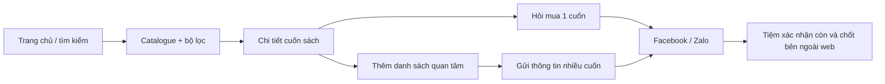
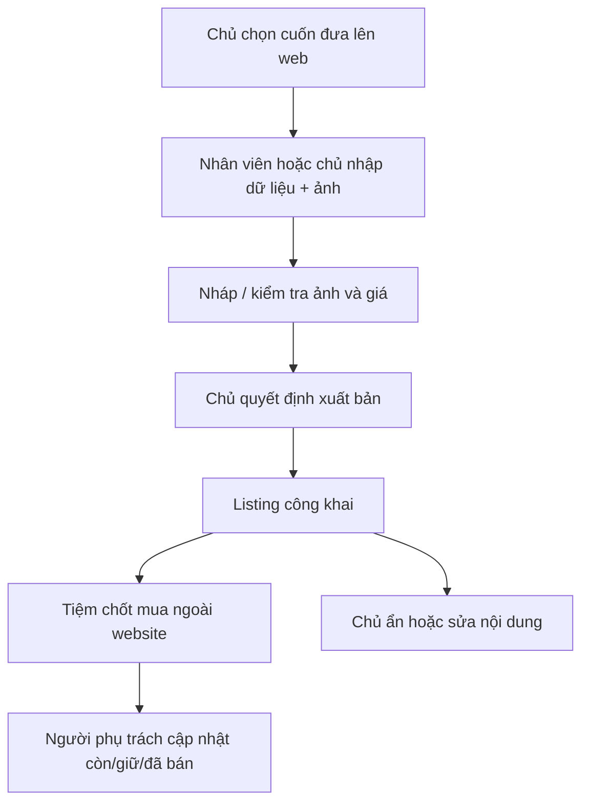
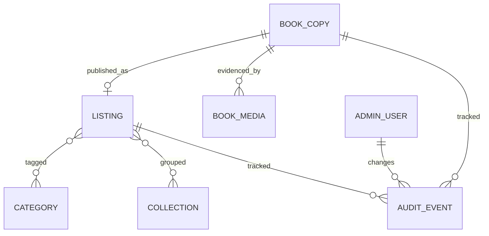
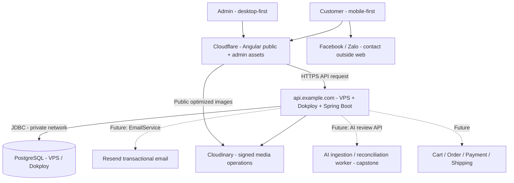

# MASTER PLAN — WEBSITE MẸ MÂY

**Bản hiện hành | Cập nhật 22/10/2026 | M0 đã duyệt; M1 local đã triển khai**

> **Mục tiêu:** Làm một website sách có trải nghiệm tìm và xem sản phẩm tương tự các website bán sách phổ biến (tham khảo [NXB Kim Đồng](https://nxbkimdong.com.vn/)), nhưng xử lý đúng bản chất sách cũ Mẹ Mây. MVP chỉ là **catalogue + danh sách quan tâm + liên hệ hỏi mua** và **quản trị sản phẩm**. Không tạo đơn, giữ hàng tự động, thanh toán hoặc thay thế vận hành Excel/Facebook/Zalo. Thiết kế có đường mở rộng lên e-commerce và capstone AI, nhưng **không xây sẵn những module chưa sử dụng**.

> **Cập nhật theo yêu cầu ngày 21/10/2026:** Giữ Angular trên Cloudflare. Backend và PostgreSQL tự quản trên VPS/Dokploy. Các proposal và phiên bản cũ đã được gộp/xóa; lịch sử xem trong Git.

> **Điều chỉnh M1 đã được duyệt ngày 22/10/2026:** triển khai nền tảng local, dùng PostgreSQL container hiện có. Docker hóa ứng dụng, CI/CD và deploy Cloudflare/VPS chuyển sang giai đoạn sau. Chi tiết thực thi và trạng thái nằm ở [báo cáo kiểm tra M1](VERIFICATION.md) và [PROGRESS](PROGRESS.md).

### Phạm vi M1 local đã thực hiện

Angular 21.2 standalone/SSR-ready; Java 21/Spring Boot 4.1.1; PostgreSQL 18.4 container có sẵn với database dev/test riêng. Đã có Flyway, session OWNER/STAFF, CSRF, bootstrap Owner idempotent, shell public/admin và đăng nhập. Contract API và cách chạy ở [README](../README.md); bằng chứng/giới hạn ở [VERIFICATION](VERIFICATION.md). Chưa có CRUD sách, Cloudinary upload, Home đầy đủ hoặc wishlist. Docker hóa ứng dụng, CI/CD và deploy được hoãn; bảng M1 bên dưới mô tả đích foundation đầy đủ, không có nghĩa staging đã nghiệm thu.

## 0. Chốt quyết định và giới hạn

| Vấn đề | Quyết định hiện tại | Ghi chú triển khai |
|---|---|---|
| Nguồn tham khảo | Website NXB Kim Đồng | Tham khảo IA/luồng UX, **không sao chép** thương hiệu, hình ảnh, UI một-một hoặc nội dung |
| Customer | **Mobile-first** | Responsive từ 360–390 px; cần thử cả Facebook/Zalo in-app browser |
| Admin/merchant | **Desktop-first** | Tối ưu bảng, form nhiều trường, quản lý ảnh và tìm kiếm; tablet dùng được, mobile admin không phải ưu tiên |
| Tính năng khách ở MVP | **A + B**: duyệt catalogue, tìm/lọc/sắp xếp, chi tiết cuốn sách, hỏi mua một cuốn, danh sách quan tâm nhiều cuốn | Danh sách quan tâm **không phải giỏ hàng**, không tạo đơn, không tự giữ sách |
| Người chọn sách trên web | **Chủ tiệm** | Nhân viên có thể hỗ trợ nhập liệu; phân quyền xuất bản theo thiết kế bên dưới |
| Chốt mua | **Facebook/Zalo**, ngoài website | Liên hệ chỉ chuyển người dùng sang kênh chat hoặc sao chép mã/link |
| Kho & đơn livestream | **Giữ luồng hiện tại** | Không ép livestream → website, không tự đồng bộ Excel/Zalo |
| Sách cũ | **Mỗi cuốn vật lý = một định danh** | Hai cuốn cùng tên khác tình trạng vẫn riêng biệt; ISBN không thay mã cuốn |
| Tech stack | Angular + Spring Boot + **PostgreSQL tự quản trên VPS/Dokploy** + Cloudinary | Modular monolith; chỉ Spring truy cập DB qua JDBC |
| Hosting frontend | **Cloudflare** | Ưu tiên Workers Assets cho Angular; chiến lược SEO/SSR/SSG phải qua spike kiểm chứng |
| Hosting backend | **VPS + Dokploy** | Spring Boot container, Dokploy quản lý deploy/route/HTTPS, tách staging và production hợp lý |
| Email | **Resend (sau MVP)** | Dự trù cổng tích hợp, chưa làm gửi mail/notification tại MVP |
| Mở rộng | Giỏ hàng/đặt hàng → thanh toán/giao vận → AI số hóa/đối soát | Phân kỳ độc lập với MVP |

### 0.1. Các mặc định để có thể làm ngay, không cần thêm vòng hỏi nghiệp vụ

1. **Có giá niêm yết cho sản phẩm được xuất bản**; nếu chủ không muốn đăng giá một cuốn, giữ cuốn ở nháp đến khi có quyết định biên tập khác. Không tự động suy ra giá từ ảnh hoặc từ bảng Excel.
2. **Chủ tiệm duyệt tập sách đăng bằng quyền xuất bản** (`OWNER`); nhân viên (`STAFF`) tạo/sửa nháp. Trường hợp chủ trực tiếp đăng, không buộc đi qua bước duyệt thừa. Đây là lựa chọn kỹ thuật mặc định, không phải khẳng định tất cả công việc ở tiệm đều cần phê duyệt.
3. **Wishlist lưu trong trình duyệt** (localStorage) và không cần tài khoản; nó chỉ tồn tại trong cùng trình duyệt/thiết bị, có thể mất khi xóa dữ liệu hoặc dùng ẩn danh. Khi mở danh sách, đọc trạng thái mới nhất từ server; không tự động gửi dữ liệu cho tiệm.
4. **Nút “Hỏi mua”** mở Facebook Page/Zalo theo liên kết được chủ cung cấp; luôn có **Sao chép mã và link** dự phòng. Không hứa prefill chat vì tùy nền tảng và kiểu liên kết.
5. **Tình trạng khả dụng** quản lý thủ công. `AVAILABLE`/`SOLD` bắt buộc; `HELD` sử dụng nếu tiệm muốn hiển thị tạm giữ. Dữ liệu website có thể trễ so với Page/livestream.
6. **Sách đã bán** tiếp tục có trang chi tiết hiển thị “Đã bán” để giữ link cũ, mặc định không ưu tiên trong danh sách. Chủ vẫn có thể ẩn riêng mục đăng.
7. **Chủ đề, độ tuổi, loại sách** là taxonomy biên tập có thể thay đổi; không gán tự động nhãn CEFR/Cambridge/Lexile hoặc độ tuổi khi không đủ bằng chứng.

Các mặc định trên là **cấu hình triển khai đề xuất**, không biến thành cam kết về chính sách giao hàng, hoàn trả hay thời hạn giữ sách. Nội dung chính sách chỉ công bố khi tiệm cung cấp nội dung hợp lệ.

## 1. Phân tích website tham khảo và mức độ học theo

### NXB Kim Đồng (quan sát nội dung trang công khai ngày 21/10/2026)

- Trang chủ tổ chức **danh mục theo độ tuổi, bộ sưu tập và nhóm sản phẩm**; có ô tìm kiếm lớn và thẻ sản phẩm.
- Trang bộ sưu tập có **lọc thể loại, nhà xuất bản, khoảng giá**, sắp xếp theo tên/giá/mới-cũ.
- Trang chi tiết có **mã sản phẩm, giá, tình trạng, ISBN, tác giả, khuôn khổ, số trang, định dạng, trọng lượng** khi được khai báo; trang Kim Đồng còn có thêm giỏ hàng/mua ngay.

**Giữ lại cho Mẹ Mây:** cấu trúc IA, danh mục/độ tuổi, card sách, tìm kiếm, sort/filter, trang chi tiết và metadata chia sẻ.
**Thay đổi cho Mẹ Mây:** ưu tiên ảnh thật của **đúng cuốn**, phần tình trạng/lỗi, loại sách Picture/Board/Chapter, bằng chứng trang ruột, mã cuốn duy nhất; thay nút giỏ/mua bằng hỏi mua/danh sách quan tâm.
**Không bê sang:** khuyến mãi giả định, kho theo số lượng của một SKU, combo tự động, đánh giá sao không có dữ liệu, checkout, tin tức phức tạp.

Nguồn tham khảo: [Trang chủ](https://nxbkimdong.com.vn/), [Ví dụ trang bộ sưu tập](https://nxbkimdong.com.vn/collections/em-biet-gi), [Ví dụ trang chi tiết](https://nxbkimdong.com.vn/products/lo-au-oi-tam-biet-tro-chuyen-ve-suc-khoe-tam-than-chung-roi-loan-lo-au).

## 2. Sitemap và UX cần thiết

Home lấy bố cục từ ảnh `docs/assets/nxbkimdong.com.vn.png` do người dùng cung cấp: nhiều hàng sách, banner ngang và footer, không chuyển sang landing kể chuyện ít sản phẩm. Thiết kế M0 đã được người dùng duyệt; xem [DESIGN](DESIGN.md). Visual chi tiết và dữ liệu pilot thật vẫn cần hoàn thiện.

| Khu vực | Route gợi ý | Nội dung MVP |
|---|---|---|
| Home | `/` | Header/search, menu danh mục, banner ngang lớn, các hàng sách/bộ sưu tập và banner xen kẽ theo ảnh tham khảo người dùng; xem DESIGN.md |
| Catalogue | `/sach` | Grid, search, filter, sort, pagination; URL giữ filter |
| Collection | `/bo-suu-tap/:slug` | Tập sách chủ/nhân viên biên tập |
| Detail | `/sach/:slug` | Gallery ảnh, ảnh lỗi, tên/giá/mã/tình trạng, mô tả, CTA, sách tương tự nếu có |
| Wishlist | `/quan-tam` | Danh sách lưu trên thiết bị; xóa sách; refresh trạng thái; copy danh sách |
| About/How to buy | `/gioi-thieu`, `/cach-mua`, `/lien-he` | Nội dung và link thật do tiệm cung cấp |
| Admin | `/admin/...` | Login, dashboard thao tác, danh sách sản phẩm, editor, media, taxonomy |

**Customer mobile-first:** thanh tìm kiếm dễ thấy; thẻ sách có ảnh nổi bật + giá + tag tình trạng; lọc hiển thị qua bottom sheet; hình thực tế có thứ tự; nút hỏi mua/danh sách quan tâm ở vùng dễ bấm; không che ảnh sách bằng banner. Điều hướng qua lại giữ từ khóa và bộ lọc.

**Admin desktop-first:** thanh điều hướng trái, bảng rộng, tìm mã nhanh, bộ lọc trạng thái, edit trên trang rộng, thao tác ảnh drag-to-reorder, preview bản công khai; không yêu cầu dashboard phân tích doanh thu.

### 2.1. Luồng khách hàng



Quy tắc sản phẩm: thao tác thêm danh sách không gọi `POST /orders`, không đổi `availability`, không tạo `reservation` ở server, không yêu cầu số điện thoại/địa chỉ khách.

### 2.2. Luồng quản trị



Không nối trực tiếp livestream claim, cọc 100.000đ/đơn, quy định giữ tối đa 2 tuần, J&T, sổ đơn Excel hay nhóm Zalo vào các luồng công khai ở MVP. Những quy tắc đó vẫn tồn tại trong vận hành thật, nhưng không có nghĩa chúng tự động áp dụng cho khách đến từ web.

## 3. Đặc tả phạm vi MVP (đủ để mở ticket)

### P0 — bắt buộc

**Public catalogue**
- Hiển thị Home, catalogue, collection, detail và các trang thông tin cơ bản.
- Search theo tên/mã, case-insensitive; hỗ trợ tiếng Việt không dấu nếu có thể thực hiện bằng PostgreSQL unaccent hoặc giải pháp tương đương; chỉ công khai published listing.
- Filter **giá, độ tuổi gợi ý, loại sách, chủ đề, khả dụng**; sort mới nhất, giá tăng/giảm. Trường dữ liệu không đầy đủ thì không đưa vào bộ lọc tương ứng.
- Mã sách/slug ổn định; HTML ban đầu cho trang sách/danh sách có SEO title/description/canonical/OG image bằng giải pháp render được **kiểm chứng trên Cloudflare** (SSR hoặc SSG với cập nhật phù hợp).
- Trang detail hỗ trợ ảnh front/back/spine/inside/defect; không buộc đủ tất cả ảnh nếu dữ liệu nguồn thiếu nhưng phải có ảnh bìa và xác thực lỗi trước khi xuất bản.
- CTA Facebook/Zalo và copy `Mã – Tên – URL`; trạng thái cuối cùng cần cửa hàng xác nhận.

**Wishlist / enquiry list**
- Thêm/xóa cuốn, badge số cuốn, trang xem tổng hợp, không cần đăng nhập.
- Client localStorage lưu ID/mã, server GET xác nhận và cập nhật tên/giá/trạng thái mới khi xem lại; cuốn đã bán hiển thị cảnh báo.
- Sao chép format nhiều dòng: `Mã | Tên | Giá tham khảo | Link`. Có phương án mở kênh chat; bản sao chép là lối dự phòng luôn hoạt động.
- Không giới thiệu là giỏ hàng, không có số lượng, không cộng phí ship, không tạo đơn.

**Admin**
- Owner/Staff login. `STAFF`: tạo, sửa nháp; `OWNER`: quản lý người dùng và xuất bản/ẩn (quy tắc đề xuất có thể cấu hình sau).
- Form tạo cuốn + listing, upload nhiều ảnh, chọn thumbnail, sắp thứ tự, loại ảnh, ghi chú lỗi và alt text.
- Cập nhật giá/trạng thái; tìm theo code; xem trước/ẩn/khôi phục; audit giá/trạng thái và người chỉnh sửa.
- Taxonomy tối thiểu cho loại sách, chủ đề, bộ sưu tập, độ tuổi gợi ý; không làm hệ CMS tổng quát.

### P1 — nên làm nếu không ảnh hưởng ra mắt

- Sách tương tự theo chủ đề/độ tuổi, danh sách “mới đăng”, tối ưu empty states.
- Chỉnh hàng loạt trạng thái **chỉ** nếu chủ tiệm có nhu cầu và đã làm pilot.
- Video sản phẩm tùy chọn nếu hạ tầng/media đã sẵn, không dùng video làm điều kiện để publish.

### Không làm trong MVP

Giỏ hàng thực, order/OrderItem, login khách, địa chỉ giao hàng, COD/PayOS/VNPay, vận chuyển/J&T, thanh toán/cọc, hold timer, phân tích doanh thu, Meta/Zalo API, đồng bộ Excel, tự đăng comment, OCR/VLM/AI, gợi ý sách bằng ML, chatbot, loyalty, review khách và quản lý tồn đa kênh.

## 4. Mô hình dữ liệu đề xuất

Chia **BookCopy (cuốn vật lý)** và **Listing (mục niêm yết)** ngay từ đầu. Điều này không buộc mọi cuốn livestream phải nhập website: chỉ tạo hoặc công khai `Listing` khi chủ chọn.



| Entity | Trường cốt lõi MVP | Lưu ý tương lai |
|---|---|---|
| `BookCopy` | `id`, `book_code` unique immutable, `title`, `isbn?`, `publisher?`, `author?`, `language?`, `format`, `condition_grade?`, `condition_note`, `availability`, timestamps/version | Từng vật thể; nguồn đối soát/sticker/ảnh phục vụ capstone |
| `Listing` | `id`, `book_copy_id` unique, `slug`, `price_vnd`, `description`, `publication_status`, `published_at`, `updated_at`, `version` | Một cuốn có thể chưa có listing hoặc listing chưa công khai |
| `BookMedia` | `id`, `book_copy_id`, `storage_public_id`, `media_url`, `type` (FRONT/BACK/SPINE/INSIDE/DEFECT/OTHER), `sort_order`, `caption?`, `source_ref?` | Metadata nguồn/loại ảnh hữu ích cho VLM/evidence; không bắt AI chạy ở MVP |
| `Category`, `Collection`, mapping | `id`, `name`, `slug`, `sort_order`, `active` | Taxonomy do chủ biên tập; độ tuổi gợi ý có cấu trúc nhưng nullable |
| `AdminUser` | `id`, credential hash, `role`, `active` | RBAC và audit |
| `AuditEvent` | actor, target ID, field, before/after (hạn chế thông tin nhạy cảm), timestamp | Reconstruct lịch sử chỉnh giá/trạng thái, provenance |

**Các bất biến:**
- `book_code` không tái sử dụng, không trùng TikTok ID (TikTok ID trên sticker thuộc về khách); ISBN không bắt buộc và **không duy nhất cho cuốn vật lý**.
- Public DTO chỉ trả các bản ghi công khai; không lộ nháp/lưu trữ qua URL, sitemap, API hay preview do web kiểm soát.
- `publication_status` (DRAFT / PUBLISHED / ARCHIVED) khác `availability` (AVAILABLE / HELD / SOLD). Không dùng nhãn “đẹp” làm thay thế ghi chú lỗi.
- Giá kiểu **số nguyên VND**, giá trước phát hành bắt buộc > 0. Có thể đổi giá, nhưng audit cần giữ lịch sử.
- `optimistic locking` (`version`/ETag) tránh người thứ hai ghi đè form đang cũ.
- Nếu triển khai C về sau, `OrderItem` tham chiếu ID cuốn và **snapshot mã/tên/giá**; transaction/lock chỉ bảo vệ cập nhật trong web, không thể bảo vệ dữ liệu Facebook chưa đồng bộ.

## 5. Kiến trúc kỹ thuật (MVP đơn giản, extension points rõ)



- **Frontend / Cloudflare:** một Angular app với `public` mobile-first và `admin` desktop-first. **Cloudflare Workers Assets** là lựa chọn triển khai mặc định để phục vụ SPA/static assets; admin dùng CSR. Public detail/catalogue **phải có spike xác minh** khả năng HTML động/SSR hoặc cơ chế SSG có chiến lược cập nhật khi chủ đăng/sửa/ẩn sách. Đừng mặc định triển khai Angular lên Workers đồng nghĩa đã có runtime SSR; giữ SEO và link preview đúng làm *release gate*. Cloudflare Pages có thể chạy site tĩnh, nhưng ưu tiên Workers theo tài liệu Cloudflare cho ứng dụng mới.
- **Backend:** Spring Boot modular monolith, module `catalogue`, `listing`, `media`, `taxonomy`, `auth`, `audit`, `contact-config`. Dùng REST API DTO versioned; validation; transactions ở boundaries thích hợp. **Không cần** microservice, event bus, search engine riêng hay Redis khi dữ liệu còn nhỏ.
- **Database:** PostgreSQL tự quản do Dokploy quản lý trên VPS, chỉ Spring truy cập qua JDBC (JPA/Hibernate + Flyway). Đặt database trong mạng nội bộ, persistent volume và database role riêng cho ứng dụng/migration. Không public cổng 5432; truy cập quản trị qua SSH tunnel/VPN khi cần. Giữ index slug/code/status/price và `unaccent` khi được bật. Không bê nguyên schema SQL Server cũ.
- **Media:** Cloudinary phục vụ ảnh tối ưu và thumbnail; backend cấp/signed upload hoặc kiểm soát tải lên; loại ảnh, kích thước, thứ tự; xử lý ảnh mồ côi khi upload thành công nhưng DB lưu lỗi. Google Drive (nếu dùng) chỉ là nơi nhân viên quản lý ảnh gốc, **không có tự động import/sync ở MVP**.
- **Security:** Spring Security session cookie `HttpOnly`, `Secure`, `SameSite` phù hợp; RBAC owner/staff, CSRF trên request thay đổi trạng thái, rate limit login/upload, MIME/size verification, HTTPS và không public Actuator nhạy cảm. Với FE `www.example.com` và API `api.example.com`, đây là **cross-origin nhưng có thể same-site**: cấu hình CORS theo origin xác định, `credentials: true`, client gửi cookies đúng chỗ; kiểm tra chính sách cookie/CSRF trong trình duyệt và staging cùng site. Không dùng CORS `*` với credentials. Nên dùng cookie host-only của API; không lưu token admin ở localStorage.
- **Deployment:** Cloudflare phục vụ Angular FE; **Dokploy trên VPS** chạy image/container Spring Boot với domain `api.example.com` qua Traefik HTTPS. PostgreSQL có service/volume riêng trên VPS; mặc định MVP có thể cùng máy với API nhưng đây là một điểm lỗi chung cần backup ngoài máy. **Không** có Angular Node SSR process trên VPS trong phương án mặc định (chỉ cân nhắc lại nếu spike Cloudflare thất bại và được chấp thuận thay kiến trúc). Cloudflare DNS quản lý `www`/`api`; CI build-test trước release, GitHub/CI triển khai FE và backend độc lập. Staging và production dùng secrets, database và tên miền tách biệt khi đi production; chi phí/quota phải đo thực tế.
- **Caching:** cache Angular JS/CSS có fingerprint dài hạn; `index.html`, HTML metadata và `/api/v1/books/**` dùng cache có TTL/invalidation thích hợp, **không cache admin response hoặc cookie/token**. Giá/trạng thái thay đổi phải thấy sau refresh; OG previews do Facebook/Zalo có cache riêng nên cần test lại và không cam kết cập nhật tức thì.

### 5.1. Hạ tầng triển khai đã chọn và các quyết định cần kiểm chứng

#### A. Luồng mạng / domain (tên minh họa, chưa mua domain)

| URL minh họa | Nơi chạy | Bảo mật / ghi chú |
|---|---|---|
| `www.example.com`, `example.com` | Cloudflare Workers Assets / Angular | Domain công khai; SPA/SSG/SSR phụ thuộc quyết định sau spike |
| `www.example.com/admin` | Cùng Cloudflare FE | Frontend route admin; **quyền thực thi do Spring API kiểm tra** |
| `api.example.com` | VPS → Dokploy/Traefik → Spring Boot | HTTPS, CORS whitelist, CSRF, auth cookie, health endpoint tối thiểu |
| PostgreSQL internal service:5432 | VPS/Dokploy, persistent volume | Chỉ JDBC từ backend; không public port hoặc kết nối browser |
| Cloudinary delivery domain | Cloudinary CDN | Chỉ giao ảnh đã xuất bản; quản lý signed uploads/delete qua API |
| Resend API | Resend, **chưa kích hoạt ở MVP** | Gọi từ Spring Boot khi đã có tính năng email |

**Kết nối PostgreSQL tự quản:**

- Backend kết nối service hostname trong private network, port nội bộ 5432; không dùng public DNS cho luồng DB cùng VPS và không public port database.
- Tách database role ứng dụng khỏi role migration/admin; giới hạn quyền theo schema, giữ credential trong secret/env của Dokploy, không ghi vào source hoặc browser bundle.
- Volume bền vững tách khỏi vòng đời container; không lưu data trong filesystem tạm. Tách database/role/volume của staging và production.
- Nếu DB và API khác máy, cần mạng riêng/VPN và TLS có xác minh certificate; cấu hình JDBC, authentication và network cụ thể phải được kiểm chứng tại M1. Không coi mạng Docker là cơ chế mã hóa.
- Chỉnh Hikari `maximumPoolSize` theo tài nguyên PostgreSQL, connection limit và số instance; Flyway chạy có kiểm soát trong release, không tự tạo schema bằng `ddl-auto: update` ở production.
- Theo dõi dung lượng disk, memory, connection count; chọn VPS sau đo tải. Ban đầu API/DB có thể cùng máy, không tuyên bố high availability.
- Backup database hằng ngày ra nơi lưu tách khỏi VPS, có retention và cảnh báo lỗi. Dùng `pg_dump`/`pg_restore` phù hợp định dạng; kiểm thử restore sang database trống, bao gồm quyền/extension cần thiết. Snapshot VPS/volume không thay cho kiểm thử phục hồi database.

**Cloudflare / SEO quyết định bằng spike tại M0/M1:**

1. Deploy thử Angular app với **Workers Assets**, cả route `/admin` và `/sach/:slug`.
2. Kiểm tra ở bản build triển khai thật: `curl` HTML ban đầu có **tên sách, mô tả, giá, OG image**, canonical, HTTP 404 cho sách không tồn tại; Facebook/Zalo crawler nhận đúng preview.
3. Kiểm tra sau khi **publish, sửa giá, sold, archive**: HTML/preview/API không giữ dữ liệu cũ do Cloudflare cache.
4. Nếu Workers Angular không có SSR tương thích: lựa chọn có kiểm chứng gồm **(a)** prerender theo danh mục đã publish + cơ chế rebuild khi thay đổi, hoặc **(b)** giải pháp edge-render/SSR tương thích được spike chứng minh. Không tự triển khai một runtime Node SSR truyền thống trên Cloudflare chỉ từ hướng dẫn static assets.
5. Nếu cả hai nhánh không đáp ứng SEO và tốc độ cập nhật, phải ghi lại trade-off và **đổi kiến trúc FE một cách có chủ đích**; không mặc định hạ yêu cầu SEO mà không quyết định.

**VPS / Dokploy:**

- VPS cần đủ RAM cho JVM + PostgreSQL + Dokploy/Traefik + hệ thống; chọn cấu hình từ smoke load test và quan sát memory, **không mặc định một size cố định**.
- Build image Spring Boot (multi-stage), health check `/actuator/health` tối giản, restart policy, giới hạn bộ nhớ và log rotation; Dokploy deploy image ổn định thay vì build production không có kiểm soát.
- Dokploy quản lý domain/routing qua Traefik. Không publish cổng container backend trực tiếp ra Internet nếu không cần; tách quyền quản trị Dokploy, SSH key, firewall, bảo vệ dashboard và định kỳ cập nhật bản vá.
- Cloudflare DNS `api.example.com` trỏ về VPS; origin sử dụng certificate hợp lệ và **Full (strict)** để không để lỏng mã hóa giữa Cloudflare và VPS. Kiểm tra việc cấp/renew certificate thực tế với chế độ proxy DNS.
- Secrets của VPS/Dokploy như `SPRING_DATASOURCE_URL`, `DB_USER`, `DB_PASSWORD`, `CLOUDINARY_*`, `SESSION_SECRET` (nếu cấu hình) nằm trong secret/env của hạ tầng, không commit vào Git; chỉ cấu hình credential PostgreSQL cần thiết cho backend.
- CI tách **PR: lint/build/test** và **release: deploy**; có rollback image tag, migration tương thích ngược khi cần. Nếu chỉ một backend instance, user admin có thể phải đăng nhập lại sau restart khi session in-memory; ghi rõ trước khi scale.

**Backup / khôi phục:**

- PostgreSQL tự quản: chủ dự án chịu trách nhiệm lịch backup, bản vá, retention và restore. Đề xuất RPO tối đa 24 giờ; retention ban đầu 7 bản ngày + 4 bản tuần ngoài VPS, quyền truy cập hạn chế và mã hóa nơi lưu. Chốt RTO sau phép thử phục hồi, không mặc định có PITR hoặc failover.
- DB backup **không đồng nghĩa backup file ảnh Cloudinary**; ghi nhận public IDs, phương án giữ ảnh gốc trên Drive hoặc xuất file định kỳ. Không mất tham chiếu media khi restore DB; kiểm thử phục hồi chéo DB/media.
- Lưu runbook cho lỗi PostgreSQL mất kết nối, DB pool cạn, VPS full disk, Cloudflare deploy lỗi, Cloudinary upload lỗi và certificate hết hạn.

**Resend — mở rộng sau MVP:**

- Không tạo bảng gửi email, OTP, notification jobs hay Resend integration endpoint ở MVP nếu không sử dụng. Có thể ghi `EmailService`/`NotificationSender` thành **contract dự kiến** trong ADR/backlog tương lai.
- Khi làm cart/order sau này: email xác nhận yêu cầu/đơn, cập nhật trạng thái, thông báo quản trị; Spring Boot là bên tạo sự kiện nghiệp vụ và gọi Resend (không để FE chứa API key).
- Khi kích hoạt: xác minh domain gửi, cấu hình DNS SPF/DKIM (xem xét DMARC), cấu hình FROM/REPLY-TO; secrets lưu trên Dokploy, ghi log ID email nhưng không log dữ liệu cá nhân quá mức.
- Xử lý thất bại bằng retry có kiểm soát và idempotency key; khi nghiệp vụ email tăng mới cân nhắc outbox/queue. Database không cung cấp hệ thống auth/email cho ứng dụng; Spring Security tiếp tục phụ trách session quản trị.

**Nguồn tài liệu chính thức để đối chiếu khi bắt đầu:**
- Cloudflare: https://developers.cloudflare.com/workers/framework-guides/web-apps/more-web-frameworks/angular/ và https://developers.cloudflare.com/pages/framework-guides/
- PostgreSQL: https://www.postgresql.org/docs/current/backup-dump.html
- Dokploy database: https://docs.dokploy.com/docs/core/databases
- Dokploy: https://docs.dokploy.com/docs/core/docker-compose/domains và https://docs.dokploy.com/docs/core/docker-compose
- Resend: https://resend.com/java và https://resend.com/changelog/idempotency-keys

### 5.2. API contract khởi điểm (minh họa)

```text
GET  /api/v1/books?q=&category=&format=&age=&minPrice=&maxPrice=&availability=&sort=&page=
GET  /api/v1/books/{slug}
GET  /api/v1/collections
GET  /api/v1/collections/{slug}
POST /api/v1/admin/book-copies
PUT  /api/v1/admin/book-copies/{id}
POST /api/v1/admin/listings
PATCH /api/v1/admin/listings/{id}/publication
PATCH /api/v1/admin/book-copies/{id}/availability
POST /api/v1/admin/media/upload-authorization
GET  /api/v1/admin/audit?targetId=...
```

MVP **không có** `POST /orders`, `/payments`, `/shipments`, `/reservations`. Có thể đổi tên endpoint khi thiết kế OpenAPI, không nên khóa tên chỉ vì proposal.

## 6. Tái sử dụng từ project Angular/Spring cũ

Từ assessment trước, **tái sử dụng pattern chứ không fork nguyên website bán điện tử**:

- Có thể tái sử dụng có chọn lọc: Angular standalone layout, pagination/forms, Spring controller/service/DTO pattern, Cloudinary adapter, Spring Security, Docker/GitHub Actions làm mẫu.
- **Không bê nguyên:** ProductVariant màu/size/quantity, Cart/Bill/PayOS, các worker vận chuyển, socket, multi-replica/Prometheus/Grafana và toàn bộ SQL Server schema.
- Rủi ro từng nêu: frontend service đụng `localStorage` trên SSR; SQL Server-specific `nvarchar(max)`; mismatch package versions/README; endpoint Actuator công khai; upload ảnh trước DB tạo orphan; pipeline CI push image trên PR. Những điểm này phải được xử lý qua build/test/đọc mã, không xem là module đã sẵn sàng.

## 7. Phân kỳ sản phẩm và đường lên capstone

| Giai đoạn | Đầu ra | Điều kiện chấp nhận |
|---|---|---|
| **MVP A+B (hiện tại)** | Public catalogue + wishlist + liên hệ; admin desktop quản lý sách/ảnh/trạng thái | Chủ có thể đăng 10–20 cuốn thật và khách có thể tự tìm/gửi yêu cầu; không phát sinh đơn web |
| **V1 e-commerce** | Giỏ hàng thực, yêu cầu đặt hàng, admin xác nhận, record đơn | Có chính sách giữ hàng, dữ liệu khách và đối soát đa kênh được đặc tả riêng |
| **V2 vận hành** | Thanh toán/cọc, giao hàng, trạng thái hoàn/hủy, có thể tích hợp tồn | Chỉ khi chủ muốn thay đổi workflow Excel/Zalo và có quyền API phù hợp |
| **Capstone R&D** | Ingestion ảnh, OCR/VLM multi-image, fusion, đối soát, confidence + human verification, đo metrics | Có tập dữ liệu chú giải, baseline, đánh giá định lượng, phân tích lỗi và phép thử thực tế |

**Không gắn capstone như một chức năng phải có để website hoạt động.** Website là nền tảng tiếp nhận, hiển thị và kiểm chứng bản ghi sách; pipeline AI chạy độc lập và chỉ đề xuất cập nhật dữ liệu qua người xác minh khi chín muồi.

### 7.1. Dữ liệu nên chuẩn bị ngay để không phải thiết kế lại

- Lưu mã từng cuốn, loại ảnh (`front`, `back`, `spine`, `inside`, `defect`), nguồn ảnh (tham chiếu nếu có), timestamps, người/phiên bản chỉnh sửa.
- Để giá chủ định ra riêng với dữ liệu có thể nhận dạng từ ảnh; tuyệt đối không học/đoán giá bán bằng OCR bìa.
- Dùng `BookCopy` làm điểm neo cho evidence; khi làm AI bổ sung `ExtractionRun`, `FieldCandidate`, `EvidenceRef`, `ReviewDecision`, `ReconciliationLink` qua migration mới, **không tạo chúng ở MVP nếu chưa dùng**.
- Nếu dùng dữ liệu livestream/sticker, tách thông tin định danh khách và số tiền/cọc khỏi dataset công khai; tối thiểu hóa, ẩn danh khi nghiên cứu.

### 7.2. Đề cương nghiên cứu tiềm năng, chưa được coi là đóng góp đã kiểm chứng

**Question:** Multi-image fusion + contextual reconciliation + selective human review có cải thiện độ đúng bản ghi sách cũ và giảm công nhập liệu so với một ảnh/OCR hay VLM cơ bản không?

**Baselines:** (B0) nhập tay; (B1) OCR đơn ảnh + rule; (B2) VLM đơn ảnh; (B3) VLM đa ảnh; (B4) đa ảnh + fusion/context + human review theo uncertainty.

**Metrics:** field-level exact match/F1 (title, ISBN, author, format, language, code nếu có ảnh), record-level validity, reconciliation precision/recall, tỷ lệ review, thời gian/cost theo record, critical error rate, số lần sửa. **Không** dùng accuracy chung duy nhất hoặc chỉ demo một vài ảnh đẹp.

**Dataset:** bắt đầu thí điểm 10–20 cuốn, sau đó xây tập chú giải đủ lớn để so sánh (mục tiêu kích thước sẽ xác định theo thời gian/nhân lực); có split theo cuốn/đầu sách để hạn chế leakage, kiểm tra agreement khi nhiều người gán nhãn. Website data được nhập tay không tự động trở thành ground truth tốt nếu thiếu quy trình xác minh.

## 8. Kế hoạch triển khai theo milestones (1 full-stack developer)

**Ước lượng lập kế hoạch: 6–8 tuần làm việc tương đối tập trung** nếu nội dung/ảnh và phản hồi có sẵn. Đây **không phải cam kết**: phần SSR, xử lý media, số cuốn, khả năng tái sử dụng code và thời gian đi học/đi làm có thể làm lệch đáng kể. Giai đoạn 0 có thể làm không cần backend production.

| Milestone | Nhóm việc | Deliverable kiểm chứng | Gate trước khi qua bước |
|---|---|---|---|
| **M0 – scope/data/UX (3–5 ngày)** | Chốt phạm vi từ tài liệu này, 10–20 cuốn thí điểm, field schema, wireframes public mobile/admin desktop, định dạng wishlist | Sitemap, design wireframes, fixture data, checklist | Không còn trường dữ liệu bắt buộc khó nhập; CTA rõ |
| **M1 – foundation (4–6 ngày, ước lượng cần hiệu chỉnh)** | Monorepo, Cloudflare Workers Assets FE, spike SEO/SSR/SSG, Spring Boot Docker trên Dokploy/VPS, PostgreSQL private JDBC/Flyway, auth/RBAC, Cloudinary adapter, CI | Local và staging chạy end-to-end; có bằng chứng HTML metadata/link preview, kết nối DB nội bộ | Không rò draft; login role hoạt động; **chọn xong chiến lược SEO và Cloudflare** |
| **M2 – admin catalogue (6–9 ngày)** | BookCopy/Listing CRUD, uploads/media order, taxonomy, publish/status, optimistic locking/audit | Admin desktop nhập thật 10–20 cuốn | Chủ tự tìm, sửa, publish, đánh dấu sold được |
| **M3 – customer UX (6–9 ngày)** | Home/catalogue/filter/search/detail/gallery, SEO/SSR/OG, contact buttons, responsive | Public mobile có metadata/link chia sẻ chuẩn | Dữ liệu trả đúng từng cuốn, tìm theo mã đúng |
| **M4 – wishlist + polish (3–5 ngày)** | Local wishlist, copy multi-book enquiry, cập nhật sold, empty states, accessibility | A+B end-to-end trên điện thoại | Không tạo order, đã bán được cảnh báo |
| **M5 – hardening/pilot/release (4–7 ngày, ước lượng cần hiệu chỉnh)** | QA iOS/Android/in-app, security, **PostgreSQL restore ngoài VPS**, Cloudflare cache/SEO, Dokploy health/HTTPS/rollback, performance, owner demo | Checklist pass, release notes, hướng dẫn nhập liệu; Cloudflare + VPS production | Hoạt động với dữ liệu thật; backup/restore, rollback thử thành công |

**Quy tắc ưu tiên khi trễ:** cắt video/collection đẹp/recommendations trước; không cắt khả năng phân biệt từng cuốn, cập nhật sold, backup, quyền admin và luồng hỏi mua. Không đưa `Order` vào làm đường tắt.

### 8.1. Backlog mở ticket ngay

- `SETUP-01` tạo repository layout, env validation, CI PR checks; `SETUP-02` PostgreSQL trên Dokploy + Flyway + seed taxonomy; `SETUP-03` VPS/Dokploy Spring staging; `SETUP-04` Cloudflare Workers Assets + **SSR/SSG/OG spike**; `SETUP-05` domain + TLS + credentials/CORS/CSRF + Cloudflare routing.
- `DATA-01` BookCopy/Listing migrations và constraints; `DATA-02` BookMedia upload lifecycle; `DATA-03` AuditEvent/versioning.
- `ADMIN-01` login + RBAC; `ADMIN-02` desktop book editor; `ADMIN-03` listing publication/status; `ADMIN-04` media gallery + thumbnail; `ADMIN-05` taxonomy/collections.
- `WEB-01` responsive shell/search; `WEB-02` product grid/filter/sort/pagination; `WEB-03` book detail/media; `WEB-04` links/contact+fallback; `WEB-05` wishlist; `WEB-06` SSR/SEO/OpenGraph.
- `QA-01` integration tests/public restrictions; `QA-02` cross-channel stale stock scenario; `QA-03` security/uploads; `QA-04` manual mobile/in-app; `QA-05` Cloudflare deployed initial HTML + share preview + status-change cache tests; `OPS-01` PostgreSQL backup ngoài VPS/restore; `OPS-02` Dokploy TLS, health, rollback, secrets; `FUTURE-EMAIL-01` Resend decision/ADR (không code MVP).

Có thể dùng GitHub Issues/Projects + PR riêng theo milestone; giao Codex các ticket có tiêu chí chấp nhận rõ. Tạo test trước hoặc cùng lúc với tính năng có dữ liệu/trạng thái quan trọng. **Chỉ triển khai phạm vi đã được duyệt; M1 local đã hoàn tất, các milestone sau cần spec tương ứng.**

## 9. Definition of Done — nghiệm thu MVP

- [ ] Chủ chọn một bộ **50–100 listing kiểm thử** (có thể có subset 10–20 ảnh thật cho pilot), cùng tên nhưng khác bản cuốn vẫn có mã/ảnh/giá/tình trạng khác.
- [ ] Customer ở iPhone Safari và Android Chrome tìm theo tên/mã, lọc kết hợp và quay lại detail không mất filters.
- [ ] Ảnh front/back/spine/inside/defect hiển thị đúng vai trò; trường thiếu không bị bịa, ảnh lỗi có thể xem khi có.
- [ ] Add/remove wishlist, reopen cùng browser còn danh sách; khác máy/ẩn danh không bị hứa đồng bộ; sách sold hiển thị cảnh báo.
- [ ] Hỏi mua một cuốn hoặc danh sách nhiều cuốn: copy mã/link chính xác; Facebook/Zalo link + fallback được thử trong browser thường và in-app browser.
- [ ] Customer click không tạo `order`, không đổi `availability`, không làm giữ chỗ.
- [ ] Admin trên laptop/desktop tạo nháp, upload, xem trước, xuất bản/ẩn, đổi giá/trạng thái; role staff không tự publish nếu không có quyền.
- [ ] Nháp/ẩn không lộ public API, sitemap và chi tiết URL; XSS/file upload/authorization được kiểm thử; concurrent edit không ghi đè âm thầm.
- [ ] Title, description, canonical, OG image theo listing ở initial HTML; 404 thật; URL chia sẻ vẫn tồn tại sau sold (trừ khi chủ archive).
- [ ] LCP mục tiêu **≤2,5 giây trong lab mobile có cấu hình đo được** trên trang đại diện; ảnh responsive/compression/lazy loading; ghi số đo chứ không tuyên bố đã đạt trước test.
- [ ] PostgreSQL production có **backup ngoài VPS đã thử restore**; ảnh Cloudinary/Drive có phương án phục hồi; thông báo rõ khi upload lỗi; có checklist rollout & rollback.
- [ ] Angular FE đã deploy qua **Cloudflare**, Spring API chạy trên **VPS/Dokploy** HTTPS; JDBC PostgreSQL private network, TLS khi qua mạng khác máy, secrets không có ở browser; login admin/cookie/CORS/CSRF được kiểm thử với domain triển khai thật.
- [ ] SEO/OG trang sách **đúng trong HTML đầu tiên hoặc phương án đã được chấp thuận qua spike**; lỗi 404 và trạng thái sold/published không bị Cloudflare cache sai.
- [ ] Có tài liệu ngắn cho chủ/nhân viên: thêm cuốn, chọn ảnh, publish/ẩn, đổi sold, xử lý hỏi mua qua chat.

## 10. Rủi ro, phụ thuộc và cách khống chế

| Rủi ro | Mức độ | Cách kiểm soát |
|---|---|---|
| Bán chéo Page/livestream nhưng web chưa cập nhật | **Cao** | Người phụ trách đổi sold ngay sau chốt; nhấn mạnh phải xác nhận trong chat; không hứa tồn realtime |
| Danh sách quan tâm bị hiểu là giỏ hàng/giữ sách | **Cao** | Ngôn ngữ UI “Quan tâm / Gửi hỏi mua”, thông báo rõ không giữ; không tạo reservation |
| Nhập 500+ cuốn thủ công thành bottleneck | Cao | **Không ép nhập toàn kho**; chủ chọn trước, pilot 10–20; sau MVP mới cân nhắc batch import |
| Ảnh thực tế nặng/quá nhiều | Trung bình | CDN/transforms, giới hạn file, thumbnails, lazy load, retention/backup hợp lý |
| SEO/OpenGraph sai khi Angular client render | **Cao** | Chốt chiến lược SSR/SSG qua spike, crawler/in-app test, cache invalidation |
| Reuse code cũ kéo rác nghiệp vụ | Trung bình | Chỉ chuyển module đủ scope, migration mới, static/security checks |
| Capstone biến MVP thành project quá lớn | **Cao** | Chỉ giữ trường metadata nguồn/audit ngay; extraction/reconciliation triển khai R&D riêng sau |
| Thu thập thông tin khách/sticker sai mục đích | **Cao** | Không đưa PII khách vào catalogue/AI mặc định; nghiên cứu cần lọc hoặc ẩn danh |
| Cloudflare Angular chỉ chạy SPA/static nhưng tưởng đã có SSR | **Cao** | M0/M1 spike deployed HTML, SEO, OG; chứng minh phương án SSG/SSR trước M3 |
| Database bị expose hoặc API kết nối sai network | **Cao** | Không public 5432; role riêng; kiểm tra private hostname/auth/TLS khi cần; đo pool |
| VPS hỏng làm dừng cả API/DB hoặc mất volume | **Cao** | Backup ngoài máy; restore drill; kiểm tra volume/disk và bản vá; chấp nhận single point of failure ở MVP |
| VPS/Dokploy dashboard hoặc API lộ công khai sai cách | **Cao** | Firewall, secrets, origin TLS, Dokploy RBAC, không expose container ports |
| Chi phí Cloudflare + VPS + lưu backup ngoài máy + Cloudinary | Trung bình | Staging footprint/quota đo thực tế, xem giới hạn gói và thông báo vượt mức |

## 11. Các bước còn lại sau M1 local

1. **Duy trì tài liệu hiện hành**: cập nhật trực tiếp bộ tài liệu này; chỉ tạo bản Word gửi chủ khi có yêu cầu.
2. **Hoàn thiện visual từ M0 đã duyệt**: customer mobile gồm Home, catalogue, detail, wishlist; admin desktop gồm list, editor, media và publish. Logo người dùng cung cấp nằm tại `code/frontend/public/logo.jpg`; chưa tích hợp vào UI.
3. **Dùng 10–20 cuốn chủ chọn làm fixture**: mã, giá, ảnh, format, tình trạng; đánh giá các bộ lọc có dữ liệu thực trước khi code giao diện sâu.
4. **Tạo technical specification sau wireframe**: ERD, OpenAPI, role matrix, testing strategy, **Cloudflare rendering spike**, **PostgreSQL private connection + offsite backup/restore test**, Dokploy release/rollback, repo structure; hosting provider đã chọn, chỉ còn chọn plan/cấu hình.
5. **Tiếp tục M2→M5**, pilot với dữ liệu thật, thu log lỗi, đo hiệu năng và thao tác nhập liệu.
6. **Sau MVP ổn định** mới mở proposal V1 (order/cart, Resend transactional emails khi có yêu cầu), đồng thời lập experimental protocol capstone (dataset, labels, baselines, metrics).

### Kết luận

Mẹ Mây không cần một bản sao NXB Kim Đồng. Cần **một catalogue sách có UX giống cửa hàng online nhưng đáng tin về từng cuốn sách cũ**, kèm admin desktop để đăng/sửa nhanh. Stack deployment được chốt ở tầng provider: **Angular trên Cloudflare; Spring Boot trên VPS/Dokploy; PostgreSQL tự quản trên VPS/Dokploy; Cloudinary media; Resend dành cho email sau MVP**. Chỉ chiến lược render public HTML/SEO trên Cloudflare còn là **spike kỹ thuật bắt buộc**. Việc chuẩn hóa `BookCopy` + `Listing` + media evidence + audit ngay từ đầu tạo nền tốt cho đặt hàng và capstone, mà **không cần trả giá bằng việc xây sớm những tính năng chưa dùng**.
