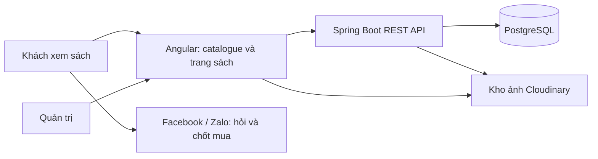

# Proposal website Mẹ Mây – Sách ngoại văn cho bé

Ngày: 21/10/2026. Trạng thái: bản đề xuất để thảo luận, chưa phải thiết kế được duyệt hay kế hoạch triển khai chi tiết.

## 1. Định hướng đã xác nhận

Website là catalogue sách. Khách xem sách và nhắn Facebook/Zalo để hỏi, giữ sách và chốt mua. Hàng chủ yếu là sách đã qua sử dụng, mỗi cuốn có tình trạng và ảnh riêng. Công nghệ theo yêu cầu: Angular và Spring.

Giá trị chính là giúp phụ huynh tìm được cuốn phù hợp, nhìn rõ tình trạng thực tế và gửi đúng mã sách khi liên hệ. Với người bán, website cần giúp đăng sách và cập nhật còn/giữ/đã bán nhanh, tránh giới thiệu nhầm cuốn đã bán.

Giả định để lập proposal: cửa hàng vận hành quy mô nhỏ, một người quản trị chính; giao diện tiếng Việt, tên sách giữ nguyên ngôn ngữ gốc; giá VND; thông tin đơn, chuyển khoản và vận chuyển tiếp tục xử lý trong quy trình hiện có. Những giả định này có thể thay đổi khi duyệt phạm vi.

## 2. Khuyến nghị và các hướng lựa chọn

| Phương án | Lợi ích | Chi phí và hạn chế | Đánh giá |
|---|---|---|---|
| **Nền dự án mới, tái sử dụng có chọn lọc** | Giữ kiến thức Angular–Spring và phần quản trị/lưu ảnh đã có; dữ liệu thiết kế đúng cho từng cuốn sách | Phải chuyển và kiểm tra từng phần, không thể copy cả luồng sản phẩm | **Khuyến nghị** |
| Fork toàn bộ shop cũ rồi sửa | Có sẵn nhiều màn hình và hạ tầng mẫu | Phải gỡ checkout, thanh toán, tài khoản khách, biến thể màu–size và nghiệp vụ điện tử; dễ giữ lại độ phức tạp không phục vụ catalogue | Chỉ cân nhắc nếu cần giữ gần như toàn bộ nghiệp vụ cũ |
| Viết mới toàn bộ | Chủ động hoàn toàn về cấu trúc và giao diện | Làm lại cả những phần tiện ích đã có; cần thêm thời gian | Phù hợp nếu phần cũ khó chuyển sau khi kiểm tra sâu |

Tái sử dụng ở đây là chuyển các phần nhỏ đã đọc hiểu và có kiểm tra phù hợp. Chưa có cơ sở để cam kết tỷ lệ phần trăm code hay thời gian tiết kiệm.

## 3. Phạm vi MVP

### Khách xem catalogue

- Trang chủ: giới thiệu Mẹ Mây, sách mới đăng, bộ sưu tập theo độ tuổi/chủ đề và cách mua.
- Danh sách sách: tìm theo tên hoặc mã sách; lọc độ tuổi gợi ý, ngôn ngữ, chủ đề, khoảng giá và tình trạng còn hàng; phân trang và sắp xếp mới nhất/giá.
- Chi tiết từng cuốn: ảnh bìa, ảnh ruột và ảnh lỗi; mô tả ngắn; giá; mã sách; tình trạng; ngôn ngữ; định dạng; độ tuổi gợi ý; tác giả/nhà xuất bản nếu biết.
- Nút liên hệ Facebook/Zalo và nút sao chép thông tin hỏi mua gồm mã sách, tên và đường dẫn cuốn đang xem.
- Trang giới thiệu, hướng dẫn mua, cách mô tả tình trạng, giao hàng/đổi trả và thông tin liên hệ theo nội dung cửa hàng cung cấp.
- Đường dẫn từng cuốn chia sẻ được, có tiêu đề và ảnh xem trước phù hợp.

### Quản trị catalogue

- Đăng nhập cho quản trị; không mở đăng ký công khai.
- Tạo nháp, sửa, xuất bản và ẩn mục bán; xem trước trước khi xuất bản.
- Tải nhiều ảnh, chọn bìa, sắp thứ tự và ghi chú ảnh lỗi. Mức đề xuất ban đầu: tối đa 12 ảnh/cuốn, mỗi ảnh đầu vào tối đa 10 MB; kiểm tra và tối ưu trước khi phục vụ khách.
- Cập nhật giá, tình trạng vật lý và trạng thái còn/giữ/đã bán.
- Quản lý chủ đề, bộ sưu tập và các lựa chọn dùng để lọc sách.
- Tìm nhanh theo mã và cập nhật trạng thái từ danh sách quản trị.
- Ghi nhận thời điểm cập nhật và tài khoản thực hiện thay đổi quan trọng.

### Ngoài MVP

Giỏ hàng, checkout, PayOS/COD trên website, tài khoản khách, mã giảm giá, đánh giá người mua, tích điểm, quản lý giao vận, chat realtime, tự đọc bình luận/inbox, đồng bộ Facebook/Zalo và tự động lấy ảnh từ Drive. Các phần này chỉ đưa vào giai đoạn sau khi có nhu cầu vận hành rõ ràng.

## 4. Luồng sử dụng và quy tắc vận hành

**Khách:** mở catalogue → lọc/chọn một cuốn → xem ảnh và tình trạng → sao chép mã/link → mở Facebook hoặc Zalo → cửa hàng xác nhận còn hàng và chốt ngoài website.

**Người bán:** tạo mục sách → thêm ảnh thực tế → xem trước → xuất bản → khi đồng ý giữ trong cuộc trò chuyện, đánh dấu “Đang giữ” → khi bán xong, đánh dấu “Đã bán”; nếu khách hủy, chuyển về “Còn sách”.

Nhấn nút liên hệ không tạo đơn và không tự giữ sách. Website cũng không biết khách đã thanh toán hay cuộc trò chuyện đã thành công. Nhân viên phải cập nhật sau khi chốt trên các kênh; đây là điểm phụ thuộc vận hành lớn nhất của MVP.

Đề xuất giữ sách thủ công, không đặt thời hạn tự động trong MVP. Hai thiết bị quản trị cùng sửa phải nhận cảnh báo nếu dữ liệu đã đổi, tránh ghi đè trạng thái mới hơn.

**Hai nhóm trạng thái độc lập:**

| Nhóm | Giá trị đề xuất | Quy tắc |
|---|---|---|
| Xuất bản | Nháp / Công khai / Lưu trữ | Chỉ mục công khai xuất hiện trong catalogue; bản nháp và bản lưu trữ không được trả về qua API công khai |
| Khả dụng | Còn sách / Đang giữ / Đã bán | Dùng cho đúng cuốn vật lý; không dùng thay cho nhãn tình trạng sách |

Cuốn đã bán vẫn có thể giữ trang công khai để đường dẫn cũ còn hữu ích: hiển thị rõ “Đã bán” và gợi ý sách tương tự. Danh sách mặc định ưu tiên sách còn. Mục bị ẩn không tiếp tục lộ qua đường dẫn hoặc ảnh xem trước do website kiểm soát; cache do nền tảng bên ngoài giữ có thể cần làm mới riêng.

## 5. Mô hình dữ liệu tổng quan

Đơn vị bán là **một cuốn vật lý**, không phải chỉ một đầu sách. Hai cuốn cùng tên nhưng khác giá, lỗi hoặc ảnh phải có mã và mục bán riêng. Nếu nhiều cuốn thực sự tương đương và nhu cầu tăng, mới bổ sung lớp gom theo đầu sách/ấn bản; chưa cần catalogue thư mục phức tạp ngay.

| Đối tượng | Nội dung chính |
|---|---|
| Mục bán sách | ID, mã duy nhất, slug duy nhất, tên, giá VND, mô tả, nhãn tình trạng, chi tiết lỗi, ngôn ngữ, định dạng, độ tuổi gợi ý, tác giả/NXB tùy chọn, ISBN tùy chọn, hai nhóm trạng thái, mốc cập nhật, phiên bản dữ liệu |
| Ảnh sách | Mục bán liên quan, URL, mã ảnh trên kho lưu trữ, loại ảnh bìa/ruột/lỗi, thứ tự, mô tả thay thế |
| Chủ đề và bộ sưu tập | Chủ đề như động vật/cảm xúc; bộ tuyển chọn như sách cho bé mới làm quen tiếng Anh; một cuốn có thể thuộc nhiều nhóm |
| Tài khoản quản trị | Định danh, mật khẩu được băm, trạng thái tài khoản và quyền quản trị |
| Lịch sử thay đổi | Ai thay đổi, lúc nào, mục nào và thay đổi trạng thái/giá quan trọng |

Quy tắc dữ liệu đề xuất: mã sách không tái sử dụng; ISBN không bắt buộc và không duy nhất; giá phải lớn hơn 0 khi xuất bản; tối thiểu có tên, mã, giá, mô tả tình trạng và ảnh bìa trước khi xuất bản. Nhãn “đẹp” không thay thế mô tả lỗi cụ thể. Không thu thập thông tin cá nhân của trẻ.

Độ tuổi chỉ là gợi ý lựa chọn sách do cửa hàng biên tập. Không yêu cầu phụ huynh cung cấp ngày sinh hoặc hồ sơ của bé.

## 6. Kiến trúc đề xuất

Một repository, một ứng dụng Angular và một backend Spring Boot theo dạng monolith chia module. Các module ban đầu: catalogue, media, quản trị và cấu hình nội dung. Không cần microservices, message broker, Redis hay công cụ tìm kiếm riêng ở MVP.

Mũi tên tới Facebook/Zalo là khách mở đường dẫn liên hệ, không phải tích hợp API hay đồng bộ dữ liệu.

| Thành phần | Đề xuất | Lý do và điều kiện |
|---|---|---|
| Frontend | Angular standalone; catalogue render phía server, quản trị render phía trình duyệt | Trang sách cần HTML và metadata sẵn khi chia sẻ; quản trị không cần SEO |
| Backend | Spring Boot, Java 21 nếu tương thích với bản Boot được chốt, REST, Validation, Spring Data JPA | Khớp yêu cầu và kinh nghiệm từ project cũ; phân tách DTO công khai với DTO quản trị |
| Database | PostgreSQL cho dự án mới | Dữ liệu sách làm mới; tránh kéo nguyên schema SQL Server theo. Nếu đã có hạ tầng SQL Server trả phí/vận hành ổn định, có thể giữ SQL Server sau khi cân nhắc |
| Migration | Migration có phiên bản, ví dụ Flyway | Tạo được môi trường mới và theo dõi thay đổi schema |
| Ảnh | Tận dụng hướng tích hợp Cloudinary | Lưu URL và public ID; không lưu binary ảnh trong database; kiểm tra tài khoản/quota trước khi triển khai |
| Xác thực quản trị | Ưu tiên session cookie HttpOnly, Secure, SameSite, cùng origin và có CSRF protection | Đơn giản cho một website cùng backend; tái sử dụng ý tưởng Spring Security/BCrypt, không mang nguyên luồng JWT localStorage sang |
| Triển khai | Reverse proxy HTTPS → Angular SSR runtime và Spring API; database riêng trong mạng nội bộ | Cần tính cả tiến trình Node cho Angular SSR; static hosting đơn thuần không chạy được SSR runtime |

Angular hỗ trợ kết hợp SSR, prerender và CSR theo route. Đề xuất dùng SSR cho catalogue thay đổi thường xuyên; prerender chỉ cho trang tĩnh. Khi xuất bản/sửa/ẩn sách, cần làm mới cache ứng dụng tương ứng để giá và trạng thái không bị cũ. Tham khảo [Angular rendering strategies](https://angular.dev/guide/routing/rendering-strategies).

Chưa khóa phiên bản Angular/Spring ở mức proposal. Khi bắt đầu cần chọn bản stable còn được hỗ trợ, xác nhận Node/TypeScript/Java và dependency tương thích, rồi pin phiên bản. Không mặc định dùng lại Angular 20.3/Spring Boot 3.5.6 chỉ vì project cũ đang có chúng. Tham khảo [Angular releases](https://angular.dev/reference/releases) và [Spring Boot](https://spring.io/projects/spring-boot/).

## 7. Thiết kế trải nghiệm

Hướng đề xuất: ấm áp, gọn và dễ đọc trên điện thoại; nền sáng, chữ có độ tương phản rõ, ảnh sách là trọng tâm. Chưa chốt palette, font hoặc layout chi tiết trong proposal này.

Trang chi tiết cần đặt giá, mã sách, trạng thái và nút liên hệ ở vị trí dễ thấy. Ảnh lỗi phải dễ tìm như ảnh ruột, tránh mô tả đẹp nhưng thiếu bằng chứng. Catalogue cần giữ bộ lọc khi quay lại từ trang chi tiết và lưu bộ lọc trong URL để chia sẻ.

Nút liên hệ phải có phương án dự phòng: sao chép mã/link và hiển thị thông tin liên hệ nếu ứng dụng chat không mở. Không cam kết có thể tự điền hoặc tự gửi tin nhắn cho mọi loại tài khoản Facebook/Zalo; kiểm tra bằng tài khoản thật trước khi chốt cách mở liên hệ.

Tìm kiếm ban đầu theo tên và mã, không phân biệt hoa thường; đề xuất hỗ trợ tiếng Việt không dấu. Không có kết quả thì hiển thị hướng dẫn bỏ bớt bộ lọc hoặc liên hệ cửa hàng. Không cần Elasticsearch ở quy mô MVP.

## 8. Tận dụng project cũ

Đã đọc README, package.json, pom.xml, một số entity/controller/service liên quan catalogue, xác thực, ảnh; Docker Compose, workflow và lịch sử commit gần nhất. Đây là khảo sát mã nguồn tĩnh, chưa chạy ứng dụng, build, kiểm thử hay kiểm toán bảo mật toàn hệ thống.

| Phần cũ | Hướng xử lý |
|---|---|
| Cấu trúc Angular standalone, service gọi API, phân trang | Tận dụng pattern; đổi DTO và route theo sách, kiểm tra tương thích SSR |
| CRUD quản trị sản phẩm, danh mục | Chuyển có chọn lọc; đổi form và quy tắc dữ liệu, chỉ giữ chức năng catalogue |
| Tìm kiếm qua JPA và Pageable | Tận dụng cách tiếp cận; viết lại điều kiện theo tuổi/ngôn ngữ/chủ đề/trạng thái |
| Upload ảnh và lưu public ID Cloudinary | Tận dụng phần kết nối; bổ sung thứ tự, vai trò ảnh, xử lý upload lỗi và giới hạn phù hợp |
| BCrypt, Spring Security | Tận dụng pattern; thiết kế lại phân quyền tối giản và session quản trị |
| Dockerfile/Compose, GitHub Actions | Dùng làm mẫu; đổi registry/name, thêm kiểm tra và quy trình staging/release |
| Product, ProductVariant, SQL schema | Thiết kế lại cho từng cuốn; bỏ màu/size và các quan hệ giỏ hàng/đơn trong MVP |
| Cart, Bill, PayOS, shipping staff, websocket, dashboard doanh thu | Không chuyển sang MVP; giữ project cũ làm nguồn tham khảo cho giai đoạn mở rộng |

Các điểm cụ thể cần xử lý khi chuyển:

1. README ghi Angular 17/Spring Boot 3.0, nhưng manifest là Angular 20.3 và Spring Boot 3.5.6; dựa vào cấu hình thực tế để đánh giá.
2. Product dùng `nvarchar(max)` và các khai báo gắn SQL Server. Chuyển database đòi hỏi sửa mapping và migration; không chỉ đổi JDBC URL.
3. ProductVariant có màu, size, quantity, price; không phù hợp khi từng cuốn có ảnh và lỗi riêng.
4. Ảnh bị giới hạn 5 ảnh; upload xảy ra trước khi lưu record ảnh. Cần xử lý trường hợp upload thành công nhưng lưu database thất bại để tránh ảnh mồ côi.
5. AuthService đọc localStorage trong quá trình khởi tạo; phải tách phần chỉ chạy trên browser nếu chuyển sang SSR. Catalogue công khai không phụ thuộc trạng thái đăng nhập quản trị.
6. WebSecurityConfig cho phép `/actuator/**` công khai; cần thu hẹp endpoint vận hành trước khi dùng cấu hình làm mẫu production.
7. pom.xml khai báo Actuator trùng và pin WebSocket 3.5.7 khác parent 3.5.6; dependency mới cần được chọn lại theo phạm vi catalogue.
8. Compose có 2 backend replica, Prometheus/Grafana và SQL Server; MVP chưa có nhu cầu mang toàn bộ cấu hình đó sang. Workflow đang gộp build/push image trong cả push và pull request; cần tách kiểm tra PR với publish release.

Xem [bằng chứng và vị trí mã nguồn](2026-10-21-legacy-assessment.md) để đối chiếu.

## 9. Lộ trình dự kiến

Ước lượng sơ bộ cho một lập trình viên full stack làm việc tập trung, người vận hành phản hồi đều và cung cấp nội dung đúng lịch: **4–6 tuần sau khi chốt phạm vi**. Đây là khoảng lập kế hoạch, không phải cam kết. Chưa có estimate theo task hay kết quả chạy project cũ để xác nhận tốc độ tái sử dụng.

| Chặng | Thời gian tham khảo | Kết quả và điều kiện qua chặng |
|---|---|---|
| 0. Chốt yêu cầu và thiết kế | 3–4 ngày | Chốt trường dữ liệu, cách liên hệ, sitemap, wireframe, quy tắc giữ/bán; thử nhập tay 10–20 cuốn vào mẫu nội dung để phát hiện thiếu trường |
| 1. Catalogue và quản trị | 7–10 ngày | Có bản staging: quản trị nhập/sửa/đăng/ẩn sách và ảnh; khách tìm/lọc/xem đúng mục công khai |
| 2. Liên hệ, chia sẻ và nội dung | 4–6 ngày | Liên hệ có mã/link và fallback; HTML trang sách có metadata; giao diện mobile, trang hướng dẫn và dữ liệu thật |
| 3. Kiểm tra vận hành và phát hành | 4–6 ngày | Đạt checklist nghiệm thu; backup/restore thử; quản trị dùng thử; phát hành và theo dõi lỗi |

Một số việc chuẩn bị ảnh/nội dung có thể làm song song với kỹ thuật. Khối lượng làm sạch dữ liệu lớn, đổi thiết kế hoặc thêm tính năng sẽ thay đổi thời gian.

Sau MVP, ưu tiên theo dữ liệu thực tế: nhập sách hàng loạt; thao tác giữ/bán hàng loạt; danh sách sách khách quan tâm để sao chép một tin; gom theo đầu sách; rồi mới cân nhắc checkout, quản lý đơn và thanh toán. Mỗi nhóm tính năng cần proposal/phạm vi riêng.

## 10. Tiêu chí nghiệm thu MVP

- Với bộ 50–100 cuốn mẫu có đủ các trạng thái, khách tìm theo mã/tên, lọc kết hợp và mở đúng cuốn; chuyển trang không làm mất bộ lọc.
- Mỗi cuốn cùng tên vẫn phân biệt được bằng mã, giá, ảnh và tình trạng riêng. ISBN trùng hoặc thiếu không ngăn nhập sách.
- Nháp/lưu trữ không lộ qua API công khai, danh sách, đường dẫn chi tiết hoặc sitemap. Quản trị trái phép không thể sửa hay upload.
- Sau khi đổi còn → giữ → đã bán, màn hình khách phản ánh trạng thái mới sau khi làm mới trang, không bị cache ứng dụng cũ che mất thay đổi.
- Upload sai định dạng/quá dung lượng có lỗi rõ; lưu ảnh thất bại không làm mất ảnh cũ hoặc báo thành công giả; xóa/chọn bìa không gây trang không có ảnh ngoài ý muốn.
- Trên điện thoại, nút liên hệ và sao chép hoạt động; kiểm tra trình duyệt thường và trình duyệt trong Facebook/Zalo bằng thiết bị thật.
- Kiểm tra HTML ban đầu có title, description, canonical và Open Graph theo cuốn; trang không tồn tại trả 404 thật. Xem trước link có ảnh/tên sách khi nền tảng lấy được metadata; ghi nhận tác động cache của nền tảng.
- Mục tiêu hiệu năng đề xuất: LCP ≤ 2,5 giây trên trang danh sách/chi tiết đại diện trong cấu hình mobile được ghi lại; kiểm tra bằng nội dung/ảnh thật trước khi chấp nhận. Đo lab trước phát hành và đo người dùng thật khi đủ dữ liệu.
- Có quy trình backup database hằng ngày, lưu tách khỏi máy chạy ứng dụng, kiểm tra phục hồi trước phát hành. Mốc mất dữ liệu chấp nhận đề xuất tối đa 24 giờ; ảnh và mã tham chiếu cần có phương án bảo toàn riêng.
- Người vận hành có thể tự đăng sách và cập nhật trạng thái trên thiết bị họ sử dụng, không cần sửa code.

## 11. Ngân sách, rủi ro và quyết định tiếp theo

Ngân sách nên tách thành phát triển ban đầu, chuẩn bị ảnh/nội dung và chi phí vận hành định kỳ. Hạng mục vận hành gồm domain, máy chạy Spring + Angular SSR, database, lưu lượng/kho ảnh, backup và theo dõi lỗi. Proposal chưa đưa báo giá nhà cung cấp vì chưa có quy mô ảnh, lượt truy cập và lựa chọn hosting; cần đối chiếu giá/quota thực tế khi chốt triển khai.

| Rủi ro | Cách giảm trong MVP |
|---|---|
| Website còn sách nhưng Facebook đã bán | Chốt người chịu trách nhiệm cập nhật; mã sách xuyên suốt; thao tác trạng thái nhanh; hiển thị cần xác nhận khi liên hệ |
| Nhập sách mất nhiều công | Chuẩn hóa mã, mẫu mô tả tình trạng và quy trình chụp ảnh; thử với 10–20 cuốn trước khi nhập hàng loạt |
| Ảnh nặng làm catalogue chậm | Ảnh kích thước phù hợp, thumbnail, lazy loading ngoài màn hình, giới hạn upload và đo thực tế |
| Copy code cũ kéo theo nghiệp vụ không cần thiết | Chuyển từng module nhỏ; đối chiếu matrix tái sử dụng và tiêu chí nghiệm thu |
| Bấm liên hệ nhưng khó biết đơn đến từ website | Đo lượt bấm/sao chép theo mã nếu được chốt; người bán ghi nhận nguồn khi chốt, không coi click là đơn hàng |
| Máy chủ hoặc database hỏng | Backup ngoài máy chủ, hướng dẫn restore và kiểm tra phục hồi |

Các quyết định còn cần duyệt: phạm vi MVP ở mục 3; cách gọi các mức tình trạng; Facebook Page/Zalo và thông tin liên hệ thật; danh mục độ tuổi/chủ đề; ngân sách vận hành và quỹ thời gian. Đề xuất hiện tại dùng quản trị thủ công, PostgreSQL và SSR cho catalogue.

Tài liệu này đã hoàn thành ở mức proposal tổng quan theo yêu cầu. Bước tiếp theo sau khi bạn góp ý là chốt thiết kế bằng văn bản và lập kế hoạch triển khai chi tiết. Chưa có code sản phẩm, cài dependency, clone/fork, commit, push hay deploy trong đợt khảo sát này.
